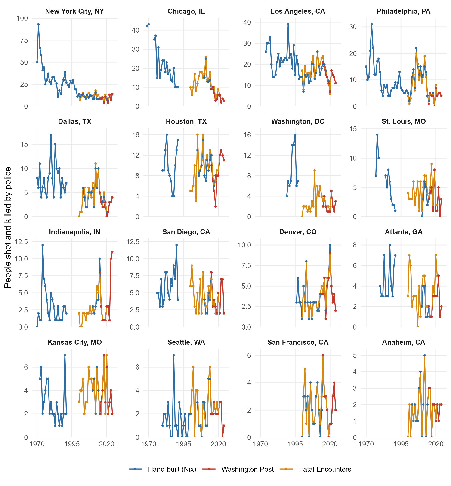

# agency-level-fatal-OIS

Annual counts of people shot and killed by on-duty police, by agency, going back as far as I can find them. The hand-built series start in 1969 for Chicago and cover 414 agencies. They sit side by side with four national sources: [*The Washington Post*'s Fatal Force](https://github.com/washingtonpost/data-police-shootings) (2015–2024), [Fatal Encounters](https://fatalencounters.org/) (2000–2021), [Mapping Police Violence](https://mappingpoliceviolence.org/) (2013–present, the only one still updating), and the FBI's Supplementary Homicide Reports (1976–2024, known to miss many police killings). Every series is keyed to the agency's FBI ORI code.

**If you just want the data:**

- [`output/agency_year_panel.csv`](output/agency_year_panel.csv) is the merged file: one row per agency-year, 4,623 agencies, 1969–2025 (145,556 agency-years). Variables are documented in [`CODEBOOK.md`](CODEBOOK.md).
- [`agency-level-fatal-ois.csv`](agency-level-fatal-ois.csv) is the original hand-built file: wide, one column per agency. It keeps the same path and format it has always had.

## November 2026 update

- **Fatal Encounters merged.** FE identifies agencies only by name, so linking it took a name → ORI crosswalk. That crosswalk is rebuilt from scratch on every run. Every match comes from one of three places:
  - a hand-checked seed;
  - an exact match on normalized name + state + agency type, accepted only when no other agency in the state (among every agency in the LEAIC and WaPo) has the same name;
  - a hand decision, with a note, recorded in [`data/crosswalks/fe_crosswalk_decisions.csv`](data/crosswalks/fe_crosswalk_decisions.csv).

  FE counts gunshot deaths that FE coded as an intentional use of deadly force. Deaths that FE's own disposition field codes as murder/suicide, accidental, or ruled suicide are dropped (89). That leaves 18,749 deaths from 2000 to 2021, of which 16,706 (89%) link to an agency in the panel.
- **Mapping Police Violence (MPV) merged.** MPV records each agency's ORI, so it joins directly, with three fixes, each written to an audit file:
  - **Same agency, different code.** 23 codes that WaPo lists under a statewide agency (mostly state police troops) are mapped to that agency's primary ORI. Three more aliases are identified from deaths that appear in both MPV and WaPo ([`data/clean/mpv_ori_aliases.csv`](data/clean/mpv_ori_aliases.csv)); Jacksonville SO, filed under FL01624 in MPV, is one. Every candidate and the reason it passed or failed is in [`output/tables/mpv_alias_candidates.csv`](output/tables/mpv_alias_candidates.csv).
  - **Missing ORIs.** Where MPV has no ORI (e.g., Columbus and Cleveland Divisions of Police), the ORI is recovered from the agency name. That works through an exact, unique name match or a hand decision in [`data/crosswalks/mpv_name_decisions.csv`](data/crosswalks/mpv_name_decisions.csv).
  - **Off-duty killings** are included in `n_mpv` and counted separately in `n_mpv_offduty`.

  MPV updates continuously, so the repo uses dated snapshots (see [Reproducing the panel](#reproducing-the-panel)). The current one runs through October 2026; complete years 2013–2025 are used.
- **FBI Supplementary Homicide Reports (SHR) added** as `n_shr`, from [Jacob Kaplan's concatenated files](https://doi.org/10.3886/E100699V16) (1976–2024). SHR is the only national source that reaches back before 2000, and it's here mainly to show how well it agrees with the others. It counts people whose killing the reporting agency coded "felon killed by police" with a firearm. That's 18,361 people over 49 years. SHR is not a census of agencies, so `n_shr` is 0 only when the agency filed some SHR record that year, and NA otherwise. It adds earlier years for agencies already in the panel, not new agencies. Its counts are listed in [`output/tables/shr_linkage.csv`](output/tables/shr_linkage.csv).
- **The WaPo merge was rebuilt.** Changes:
  - It reads local, checksummed copies of the archived v2 data instead of live URLs.
  - It handles agencies that WaPo lists under several ORIs. The old merge silently missed 96 of them.
  - It writes the merged file to disk.
- **Agency key fixes.**
  - Five wrong ORI codes corrected: Forsyth Co. SO, Macon-Bibb Co. SO, Richmond Co. SO, and Gwinnett Co. PD (all GA), plus Louisville Metro PD.
  - Missing ORIs filled in for Orange Co. SD (CA), Arlington Co. PD (VA), and two small Minnesota departments.
  - Every fix was confirmed by year-by-year agreement with WaPo or from the LEAIC. The reasons are recorded in [`data/agency_key.csv`](data/agency_key.csv).
- **Two pairs of columns now share an ORI** and are summed in the panel: Savannah PD and Savannah-Chatham Metro PD, and Bibb Co. SO and Macon-Bibb Co. SO. That's why 416 columns become 414 agencies.

## What these data can show

Are police killing more people now than in decades past? National data can't answer that, because they only start in 2000 (Fatal Encounters), 2013 (MPV), or 2015 (WaPo). But many agencies can be followed back further, and comparing each agency only to itself avoids mistaking changes in *which* agencies are observed for changes in killings.


**How the trend is estimated.** The solid line comes from a Poisson model with agency fixed effects, fit to 413 of the 414 hand-built agencies. It compares each agency with itself, so agencies entering or leaving the data don't move the line. The hand-built series end in 2022. For agencies whose series run into 2021–22, 2023–24 are filled with WaPo counts and 2025 with MPV on-duty counts. WaPo is used where it exists because it tracks the hand-built counts more closely in the years just before the switch.

Some series are left out because they mix in nonfatal shootings or may count incidents rather than people:
- Las Vegas, all years;
- Cincinnati before 2015;
- Austin, 2000–2007.

**How far back it reaches.** Before 2000, the solid line rests on only 4–19 departments, mostly large cities. It describes big cities, not the country.

**What it shows.** The headline compares one fixed set of agencies: the 17 with at least five years of data both before 1995 and since 2015, shown as the dashed line. In those agencies, fatal police shootings since 2015 run 49% below their 1970–1994 level (ratio 0.51, 95% CI 0.35–0.74).


**Then vs. now.** In the same 17 agencies, 10 kill fewer people a year now than before 1995. The drops are largest in New York, Chicago, and Los Angeles.

These are raw counts, not rates per resident, and population change could push the per-resident comparison either way. Some of these cities grew; others, like St. Louis and Philadelphia, shrank. The years observed in each era also vary by agency (see the table).


**Reach.** The hand-built agencies were involved in at least 32% of everyone shot and killed by police in WaPo's data, 2015–2024. It's "at least" because deaths are matched through each WaPo agency's primary ORI, so some matches are missed. The 27 agencies shown above carry the long-run record back before 2000.

**Sources for these numbers:**
- Tables: [`output/tables/trend_summary.csv`](output/tables/trend_summary.csv), [`trend_index.csv`](output/tables/trend_index.csv), [`then_vs_now.csv`](output/tables/then_vs_now.csv), and [`coverage_share.csv`](output/tables/coverage_share.csv).
- Script: [`scripts/07_figures_trends.R`](scripts/07_figures_trends.R).

## How the sources compare

Where they overlap, the sources mostly agree, though FE runs higher than WaPo:

| Comparison | Years | Agency-years | Correlation | Total deaths, difference | Identical counts | Identical, where either > 0 |
|---|---|---:|---:|---:|---:|---:|
| Hand-built vs. WaPo | 2015–2022 | 2,641 | .945 | WaPo −4.0% | 95.2% | 86.8% |
| Hand-built vs. FE | 2000–2021 | 5,587 | .907 | FE −1.2% | 91.2% | 69.3% |
| WaPo vs. FE (hand-built agencies) | 2015–2021 | 2,870 | .973 | FE +9.2% | 90.1% | 71.1% |
| Hand-built vs. MPV (on-duty) | 2013–2022 | 3,357 | .936 | MPV −2.2% | 89.9% | 71.4% |
| Hand-built vs. FBI SHR | 1976–2022 | 3,230 | .875 | SHR −29.0% | 65.9% | 31.5% |

Most agency-years are zero in both sources, so the last column, which drops agency-years where both are zero, is the tougher test. Agencies that WaPo lists under several ORIs (mostly state police) are left out of these comparisons. MPV's gap against the hand-built counts shifts over time: about 10% below in 2013–15 and 3–9% above in 2020–22. This is consistent with MPV recording a growing share of deaths over its life, and it's why the trend figures prefer WaPo where WaPo exists. [`output/tables/source_agreement.csv`](output/tables/source_agreement.csv) also compares MPV with WaPo and FE, and has each comparison restricted to the years all three sources cover (2015–2021). Agencies where the sources disagree are listed, largest gap first, in [`output/tables/source_disagreements.csv`](output/tables/source_disagreements.csv).

**SHR runs well below every other source,** and the gap changes over time. Against the hand-built counts it is 11% low in 1976–89 and 20% low in the 1990s, but 43% low in 2000–09 and 35% low in 2010–22. Against WaPo, FE, and MPV it is 42–57% low (see `source_agreement.csv`). Some agencies report other homicides to SHR but not their own killings, which produces false zeros. New York filed none for most of the 2000s, and Chicago filed none after 2018, when the FBI moved to NIBRS. SHR also files a death under the reporting agency, which is sometimes the investigating agency rather than the one whose officer fired. Treat `n_shr` as a lower bound, and don't read its zeros as zero.



## Coverage

| Decade | Agencies with hand-built data | WaPo | FE | MPV | SHR |
|---|---:|---:|---:|---:|---:|
| 1969 | 1 (Chicago) | — | — | — | — |
| 1970s | 4–15 | — | — | — | 1,760–1,929 (1976+) |
| 1980s | 12–15 | — | — | — | 1,695–1,960 |
| 1990s | 12–20 | — | — | — | 1,459–1,818 |
| 2000s | 112–172 | — | 2,967 | — | 1,524–1,721 |
| 2010s | 361–369 | 3,647 (2015+) | 2,967 | 4,622 (2013+) | 1,584–1,841 |
| 2020s | 225–368 (through 2022) | 3,647 (through 2024) | 2,967 (through 2021) | 4,622 (through 2025) | 1,864–2,098 (through 2024) |

The WaPo, FE, and MPV columns count agencies with an ORI. WaPo and MPV are national censuses, so an agency gets a zero from each where that source recorded no deaths. There is one exception: agencies known only from MPV get NA for WaPo rather than zero, because WaPo having no agency with that code can reflect a coding difference. The FE column counts linked agencies only. The SHR column counts panel agencies that filed any SHR record that year.

## Background

I'm building a database of fatal officer-involved shootings at the agency-year level, going back in time as far as possible. [This article in *The Lancet*](https://t.co/zDLTHrysAv) suggests police are killing more people today than they did in the 1980s, but [I remain skeptical](https://twitter.com/jnixy/status/1635677916762886149). So I'm compiling annual counts of people shot and killed by on-duty officers for as many agencies as I can.

I started with this excellent book:

- William A. Geller & Michael S. Scott (1992). *Deadly Force: What We Know.* Police Executive Research Forum.

It contains yearly counts of fatal and nonfatal police shootings for the following agencies:

| Agency | Years included |
|---|:---:|
| Chicago | 1974–91 |
| Dallas | 1970–91 |
| Philadelphia | 1986–91 |
| NYPD | 1970–91 |
| LAPD | 1980–91 |
| Houston | 1980–91 |
| Atlanta | 1980–91 |
| St. Louis | 1984–91 |
| San Diego | 1980–91 |
| Indianapolis | 1970–91 |
| Kansas City, MO | 1972–91 |

I decided, for now at least, to focus on fatal shootings, since they're more reliably reported. From there, I gathered more recent data from the sources below. I started with the largest 100 or so agencies, but added others, regardless of size, as I came across them.

| Source | Years included | Coverage |
|---|:---:|---|
| [Washington Post](https://github.com/washingtonpost/data-police-shootings) | 2015–2024 | Nationwide |
| [Fatal Encounters](https://fatalencounters.org/) | 2000–2021 | Nationwide (separate column; not used to fill gaps) |
| [Mapping Police Violence](https://mappingpoliceviolence.org/) | 2013–present | Nationwide (separate column; fills 2025 in the trend figures) |
| [Tampa Bay Times](https://projects.tampabay.com/projects/2017/investigations/florida-police-shootings/database/) | 2009–2014 | Florida |
| [Honolulu Civil Beat](https://cbmultimedia.pythonanywhere.com/) | 2010–2022 | Hawaii |
| [Salt Lake Tribune](http://local.sltrib.com/charts/shootings/policeshootings.html) | 2005–2014 | Utah |
| [Maine Attorney General's Office](https://www.pressherald.com/interactive/maine-police-deadly-force-lethal-database/) | 1990–2012 | Maine |
| [Atlanta Journal-Constitution](https://investigations.ajc.com/overtheline/database/) | 2010–2020 | Georgia |
| [Star Tribune](https://www.startribune.com/every-police-involved-death-in-minnesota-since-2000/502088871/) | 2000–2022 | Minnesota |
| [Vice News](https://news.vice.com/en_us/article/a3jjpa/nonfatal-police-shootings-data) | 2010–2016 | 50 largest local police departments |
| *The Texas Tribune's* ["Unholstered" data](https://apps.texastribune.org/unholstered/) | 2010–2015 | 36 largest cities in Texas |
| [Binder, Scharf, & Galvin (1983)](https://nij.ojp.gov/library/publications/use-deadly-force-police-officers-final-report) | 1976–1979 | Detroit, Honolulu, Newark, Oakland, San Diego, San Jose, St. Louis |
| *Washington Post* [story from 1998](https://www.washingtonpost.com/wp-srv/local/longterm/dcpolice/deadlyforce/police1page1.htm) | 1989–1997 | DC Metro PD |
| [NYPD](https://www.nyc.gov/site/nypd/stats/reports-analysis/use-of-force.page) | 1971–2022 | NYPD |
| [San Francisco PD](https://www.sanfranciscopolice.org/sites/default/files/2022-02/SFPDOISInvestigationsSheet20220215.pdf) | 2000–2022 | San Francisco PD |
| [Houston PD](https://www.houstontx.gov/police/ois/) | 2005–2022 | Houston PD |
| [Springfield (MO) PD](https://www.springfieldmo.gov/3755/Officer-Involved-Shootings) | 2008–2022 | Springfield (MO) PD |
| [Austin open data portal](https://data.austintexas.gov/Public-Safety/Officer-Involved-Shooting-2000-2014/63p6-iegi) | 2000–2014 | Austin PD |
| [Dallas open data portal](https://www.dallasopendata.com/Public-Safety/Dallas-Police-Officer-Involved-Shootings/4gmt-jyx2) | 2003–2022 | Dallas PD |
| *Omaha World-Herald* lists of fatal shootings by Omaha police (Jan. 3, 1991; Feb. 15 and 17, 2002; May 24, 2007; Mar. 18, 2008) and coverage of individual cases, via NewsBank. 1992 is derived from a 1990–2000 total; 2009 rests on finding no reported killings | 1981–2009 | Omaha PD |
| *Omaha World-Herald* coverage of Lincoln police shootings (Oct. 22, 1991; Aug. 4, 1992; Jan. 5, 2008, which calls that shooting the first fatal one by a Lincoln officer in more than 15 years; Mar. 19, 2009), via NewsBank | 1991–2009 | Lincoln PD |
| Jacksonville Sheriff's Office, [*Police Involved Shootings*](https://web.archive.org/web/20150717050006/http://www.jaxsheriff.org/departments/sheriffs-office/docs/sheriff-john-rutherford/police-involved-shootings-final.aspx) (Jan. 2009; archived copy) | 2007–2008 | Jacksonville SO |
| [Cincinnati open data portal](https://data.cincinnati-oh.gov/Safety/PDI-Police-Data-Initiative-Officer-Involved-Shooti/r6q4-muts) | 1996–2019 | Cincinnati PD |
| [Vermont open data portal](https://data.vermont.gov/Public-Safety/Vermont-State-Police-Officer-Involved-Shootings-19/du86-kfnp) | 1977–2022 | Vermont State Police |
| [COPS Office report on LVMPD](https://cops.usdoj.gov/RIC/Publications/cops-p273-pub.pdf) | 1990–2011 | Las Vegas Metro PD |
| [ACLU report](https://www.aclusocal.org/sites/default/files/aclu_socal_report_on_apd_use_of_force_nov_2017.pdf) (Nov. 2017) | 2003–2016 | Anaheim PD |
| [Mike White](https://cvpcs.asu.edu/sites/default/files/content/projects/ER%20-%20external%20DF.pdf) | 1970–1992 | Philadelphia PD |
| [David Klinger](https://journals.sagepub.com/doi/10.1177/1088767911430861) | 1996–2008 | LAPD, LASD |
| LASD Special Counsel Merrick J. Bobb, semiannual reports [5th](https://clearinghouse-umich-production.s3.amazonaws.com/media/doc/5168.pdf) (1996), [10th](https://clearinghouse-umich-production.s3.amazonaws.com/media/doc/5173.pdf) (1999), and [30th](https://clearinghouse-umich-production.s3.amazonaws.com/media/doc/42738.pdf) (2011): people killed in hit shootings. For 1996–2008 the hand-built series keeps Klinger's counts; Bobb's run about 5% higher (155 vs. 147), by at most 2 a year | 1991–1995, 2009 | LASD |
| [LASD person-level shooting data](https://services.arcgis.com/RmCCgQtiZLDCtblq/arcgis/rest/services/Person_Details_Suspect_Involved_Shootings/FeatureServer/0) (LA County open data): people recorded as deceased | 2010–2014 | LASD |
| [Report on police shootings in Alaska](https://scholarworks.alaska.edu/handle/11122/11933) | 2010–2020 | Anchorage PD |
| [SPD use-of-force report](https://s3-us-west-2.amazonaws.com/docs.puppycidedb.com/seattlepd/UseofForce2000.PDF) | 1980–2001 | Seattle PD |
| [Denver independent monitor](https://s3-us-west-2.amazonaws.com/docs.puppycidedb.com/denverpd/OIM/Annual+Reports/2006_Annual+Report.pdf) | 1996–2006 | Denver PD |
| Rojek, Nix, Wolfe, et al. (2019), [*Analysis of 2018 Use of Deadly Force by the Phoenix Police Department*](https://jnix.netlify.app/files/pdfs/report_pf_phx_ois.pdf), National Police Foundation | 2009–2018 | Phoenix PD |
| [Phoenix open data portal](https://www.phoenixopendata.com/dataset/ois) | 2017–2022 | Phoenix PD |

## Caveats

1. **Any mistakes are mine.** I did my best to make sure the data permit apples-to-apples comparisons. Each number *should* represent a person fatally shot by an on-duty officer. A few exceptions are known:
   - **Cincinnati before 2015 and all of LVMPD** count fatal and nonfatal shootings together (animal shootings excluded). That's why Cincinnati is the big outlier in [`output/figures/source_agreement.png`](output/figures/source_agreement.png).
   - **Austin 2000–2007** may be incident-level rather than person-level.
   - **Athens-Clarke 2019:** the hand-built count (5) equals WaPo's police department and sheriff's office combined. The AJC data may combine the two agencies.
2. **Blank is not zero** in the hand-built series. A blank means I have no data for that agency-year.
3. **How the national sources are counted:**
   - **WaPo and MPV zeros are mostly real.** Both are national censuses, so an agency with no record in a year gets 0. The exception is an agency one source files under a different ORI than the other. The MPV alias and code mappings fix the cases that can be detected, and agencies known only from MPV get NA for WaPo.
   - **FE zeros are real only for linked agencies.** For an agency linked to FE, 0 means no FE deaths that year. An agency never linked to FE is left NA, because a missed name match is not a zero.
   - **Pre-2013 FE is less reliable.** It was assembled after the fact from news reports, so treat the early years with more caution than WaPo.
   - **FE's "Deadly force" code is not purely on-duty police shootings.** About 5% of the deaths it keeps have descriptions mentioning a self-inflicted, accidental, or off-duty shooting. Examples include murder-suicides by off-duty officers and a training accident. Some of these are legitimate police shootings (an off-duty officer stopping a robbery), so they are flagged in `n_fe_flagged`, not dropped. Subtract `n_fe_flagged` for a conservative count. Flagged deaths explain roughly half of FE's excess over WaPo.
4. **Multi-agency incidents.** In WaPo, FE, and MPV, a death involving several agencies counts once for each agency listed. `n_fe_multi` and `n_mpv_multi` report how many of an agency's deaths were shared. Don't sum the national columns across agencies and call it a national total.
5. **Agencies WaPo lists under several ORIs** (mostly state police and highway patrols) are each assigned one primary ORI and flagged `wapo_multi_ori`. WaPo also splits Georgia State Patrol into two records; both are assigned to GAGSP00 (see `scripts/02_wapo.R`).
6. **Off-duty killings.** The hand-built series counts on-duty shootings. MPV includes off-duty killings in `n_mpv` and counts them in `n_mpv_offduty`; subtract them to match the hand-built definition. WaPo includes off-duty officers acting in an official capacity.
7. **MPV coverage has grown over time.** Against the hand-built counts it runs about 10% low in 2013–15 and a few percent high in 2020–22. Trends built only from MPV may overstate recent increases.
8. **SHR undercounts, and by different amounts in different decades** (see [How the sources compare](#how-the-sources-compare)). Its zeros can be false, and its 2021 count is depressed by the FBI's move to NIBRS.

## Reproducing the panel

Requires R (≥ 4.3) and the packages `tidyverse`, `here`, `janitor`, `digest`, `scales`, `fixest`, and `patchwork`. To use a newer MPV snapshot, first run (Python, with `requests` and `pandas`):

```sh
python tools/fetch_mpv/fetch_mpv.py
```

That saves a dated copy of MPV's current data to `data/raw/mpv/` and records it in [`data/crosswalks/mpv_snapshots.csv`](data/crosswalks/mpv_snapshots.csv). The pipeline always uses the newest snapshot. Then, from the project root:

```sh
Rscript scripts/00_run_all.R
```

| Script | What it does |
|---|---|
| `01_nix_long.R` | Reshapes the hand-built file to agency-year and attaches ORIs |
| `02_wapo.R` | Builds WaPo agency-year counts |
| `03_fe_crosswalk.R` | Builds the FE name → ORI crosswalk and writes the review queue to `output/fe_review/` |
| `04_fe.R` | Builds FE agency-year counts and the linkage table |
| `04b_mpv.R` | Builds MPV agency-year counts: ORI aliases, name recovery, linkage table |
| `04c_shr.R` | Builds FBI SHR agency-year counts (police killings with a firearm) and the linkage table |
| `05_combine.R` | Builds the panel, the agreement and coverage tables |
| `06_figures.R` | Draws the source-comparison figures |
| `07_figures_trends.R` | Draws the trend, then-vs-now, and coverage figures |

The WaPo raw files are in the repo, with checksums. Four inputs are not:
- **Fatal Encounters final release** (needed for steps 03–04): linked rather than redistributed.
- **MPV snapshot** (step 04b): linked rather than redistributed; fetch it as above.
- **Kaplan's concatenated SHR** (step 04c): distributed by ICPSR through openICPSR (project 100699); linked rather than redistributed.
- **Law Enforcement Agency Identifiers Crosswalk** (ICPSR 35158, step 03): ICPSR's terms don't let me redistribute it.

 [`data/README.md`](data/README.md) says where to get each. The published outputs are already in the repo either way.

To add an FE match or correct one:
1. Check `output/fe_review/` for candidates, then add a row to `data/crosswalks/fe_crosswalk_decisions.csv`.
2. Rerun the pipeline.

## Contributing

Found an error, or a source I've missed? Open an issue. Thanks to [Ash Bruha](https://www.viprlab.org/author/ash-bruha/) of the [VIPR Lab](https://www.viprlab.org/) for the Seattle and Denver series (Nov. 2025).

`tools/historical_ois/` holds the tools used to look for counts from before each series begins. They rank agencies, search the Wayback Machine for archived department reports, and log every count found to [`data/historical/historical_ois_evidence.csv`](data/historical/historical_ois_evidence.csv). Each logged count has its source, page, and a verbatim quote. Counts of incidents, or of everyone shot rather than people killed, are logged there but kept out of the panel. The January 2026 website scraper these tools replace is archived in `tools/data_source_scouting/archive/`.

## Citation

See [`CITATION.cff`](CITATION.cff). Please also cite *The Washington Post*, Fatal Encounters, and Mapping Police Violence if you use their series. If you use `n_shr`, cite Kaplan, J. *Jacob Kaplan's Concatenated Files: Uniform Crime Reporting (UCR) Program Data: Supplementary Homicide Reports (SHR), 1976–2024.* Ann Arbor, MI: Inter-university Consortium for Political and Social Research [distributor]. https://doi.org/10.3886/E100699V16

## License

- **Code** (`scripts/`, `tools/`) is released under the [MIT License](LICENSE).
- **Data** (everything under `data/` and `output/`, plus `agency-level-fatal-ois.csv`) is released under [CC BY-NC-SA 4.0](LICENSE-DATA). The merged panel adapts *The Washington Post*'s Fatal Force data, which carries the same license, and share-alike requires adaptations to keep it.

## Earlier updates

- **11.20.2025.** Ash Bruha found fatal OIS data for **Seattle PD**, 1980 through mid-2001, in [an SPD report](https://s3-us-west-2.amazonaws.com/docs.puppycidedb.com/seattlepd/UseofForce2000.PDF). She also found data for **Denver PD**, 1996–2006, in an [independent monitor's report](https://s3-us-west-2.amazonaws.com/docs.puppycidedb.com/denverpd/OIM/Annual+Reports/2006_Annual+Report.pdf).
- **1.4.2025.** First WaPo merge (see this [blog post](https://jnix.netlify.app/post/post27-historical-ois-update/)). It now lives in `scripts/02_wapo.R`.
