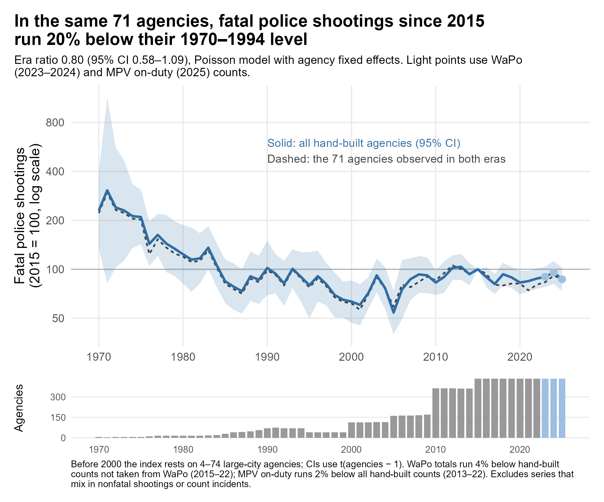
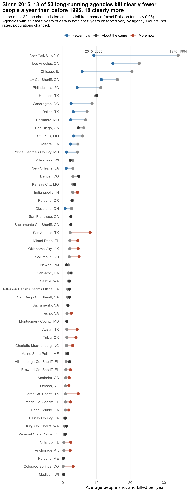
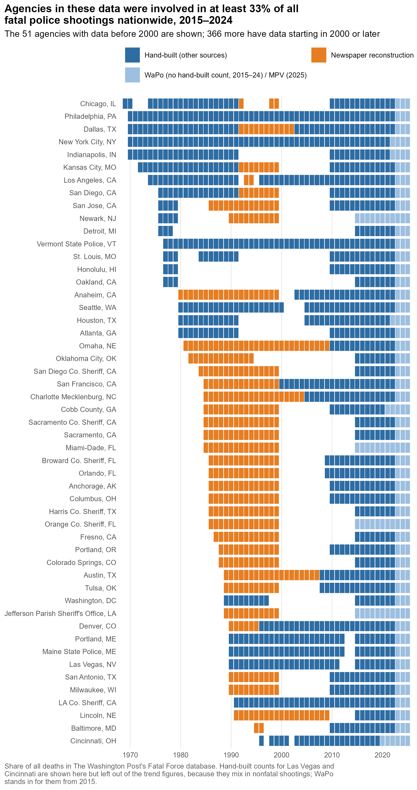
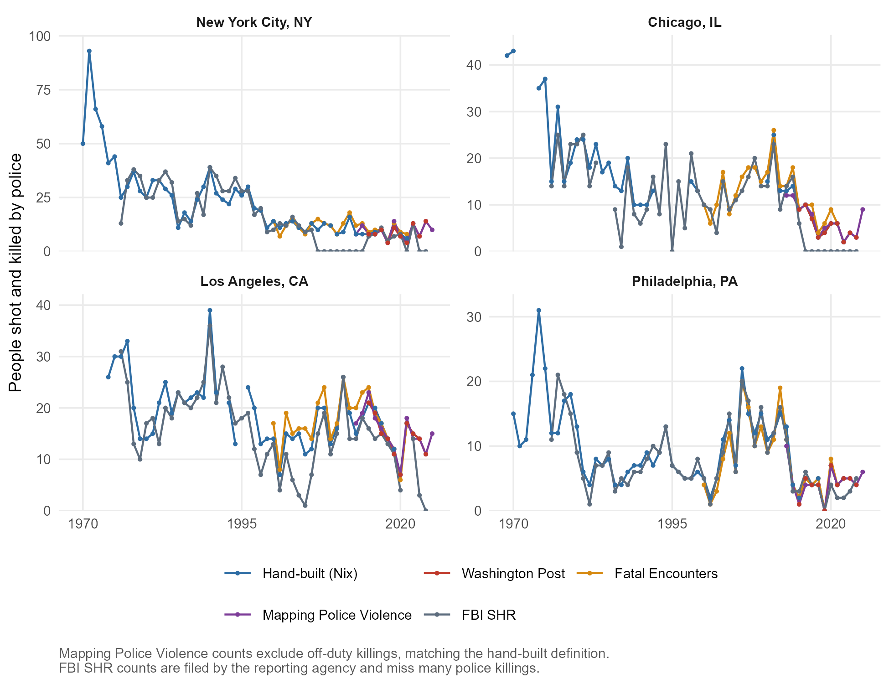

# agency-level-fatal-OIS

Annual counts of people shot and killed by on-duty police, by agency, going back as far as I can find them. The hand-built series start in 1969 for Chicago and cover 438 agencies. They sit side by side with four national sources: [*The Washington Post*'s Fatal Force](https://github.com/washingtonpost/data-police-shootings) (2015–2024), [Fatal Encounters](https://fatalencounters.org/) (2000–2021), [Mapping Police Violence](https://mappingpoliceviolence.org/) (2013–present, the only one still updating), and the FBI's Supplementary Homicide Reports (1976–2024, known to miss many police killings). Every series is keyed to the agency's FBI ORI code.

**If you just want the data:**

- [`output/agency_year_panel.csv`](output/agency_year_panel.csv) is the merged file: one row per agency-year, 4,624 agencies, 1969–2025 (145,657 agency-years). Variables are documented in [`CODEBOOK.md`](CODEBOOK.md).
- [`agency-level-fatal-ois.csv`](agency-level-fatal-ois.csv) is the original hand-built file: wide, one column per agency. It keeps the same path and format it has always had.

## What's new (November 2026)

- **The long-run comparison is being redone on a pre-specified random sample.** The headline below rests on agencies that were chosen because they had a usable newspaper archive, and it drifted as agencies were added. A protocol deposited before further collection fixes the design:
  - a frame of 309 police departments and sheriff's offices that served at least 100,000 people in 1985–94;
  - an outcome-blind audit of each agency's newspaper archive;
  - a stratified draw (seed 20261115) of 28 certainty and 28 sampled agencies;
  - the counting rules and analysis plan.

  Protocol: [doi.org/10.5281/zenodo.24248721](https://doi.org/10.5281/zenodo.24248721). Code and draw: tag [`protocol-v1.0`](https://github.com/jnixy/agency-level-fatal-OIS/tree/protocol-v1.0); scripts `08_sampling_frame.R`, `08b_coverage_audit.R`, `08c_draw_sample.R`. **Collection is complete, and the results are [below](#results-from-the-pre-registered-sample).**
- **Sixty-five agencies' pre-2000 gaps are filled from local newspapers** (see [Newspaper reconstructions](#newspaper-reconstructions)), plus a period total for the LA County Sheriff (1985–Jul 1990).

## Results from the pre-registered sample

Of the 56 drawn agencies, 54 have at least five years of data in each era and enter the comparison. Polk County SO (FL) and Baltimore County PD (MD) fall short, because their papers enter NewsBank in August and September 1990. No agency was dropped for low recall. The LA County Sheriff is below the 70% line, but it enters on the *Daily News* period total under an approved deviation (see below). The Stark County SO (OH) and the Amherst (NY) PD had no deaths in either era, so they carry no information about change and are set aside. That leaves 52 agencies, with 3,025 deaths before 1995 and 1,585 since 2015.

The protocol fixed two estimands in advance, each in counts and in rates per 100,000 residents:

| | Counts | Rates per 100,000 |
|---|---|---|
| **Pooled ratio:** all deaths since 2015 vs. before 1995, per year | 0.97 (95% CI 0.69–1.35) | 0.83 (0.61–1.13) |
| **Typical-agency ratio:** the change in the typical agency | 2.01 (1.40–2.89) | 1.71 (1.28–2.27) |

**The two answers diverge, as the protocol expected.**
- **Pooled across agencies,** fatal police shootings are about where they were before 1995: 3% lower in counts, and 17% lower per resident. Neither difference is distinguishable from no change.
- **The pooled ratio is dominated by a few very large departments.** New York, Chicago, Philadelphia, Dallas, and the LAPD kill far fewer people now than they did then. Without the four largest departments (New York, Los Angeles, Chicago, and Houston), the pooled ratio rises to 1.39 (1.02–1.88).
- **The typical agency in the universe kills about twice as many people a year now as before 1995** (1.7 times as many per resident). Many of the agencies that rose are fast-growing suburban and Sun Belt departments: Aurora (CO), Colorado Springs, Harris County, San Antonio, and the Lexington County (SC) SO.
- **Agency by agency** (exact Poisson test of the two eras' yearly counts, p < .05), 11 of the 52 agencies kill clearly fewer people now, 13 clearly more, and in 28 the change is too small to tell from chance. In rates per resident, the split is 12 fewer, 11 more, and 29 the same.

**What these estimates generalize to.** The sample stands for the 155 frame agencies with a usable newspaper archive, not for every agency that served 100,000 people. Compared with the 154 agencies without a usable archive, those agencies had higher SHR rates of police killings in 1985–94: an agency average of 0.26 vs. 0.16 per 100,000 a year (Wilcoxon p < .001). Their *Post* rates in 2015–24 are about the same (0.45 vs. 0.44, p = .82). So agencies with an archive started higher and ended about level with the rest. If the SHR's 1985–94 rates track the true ones, the agencies left out fell less (or rose more), and limiting the study to agencies with an archive tilts the estimates toward a decline.

The 11 certainty agencies with no usable archive are listed with their SHR, Fatal Encounters, and *Post* counts in [`sample_certainty_unusable.csv`](output/tables/sample_certainty_unusable.csv): Suffolk County, Detroit, Nassau County, Phoenix, Honolulu, Jacksonville, Memphis, Las Vegas, Boston, El Paso, and Nashville.

**Robustness.** Neither estimand is driven by the measurement choices:

| Run | Pooled (counts) | Typical agency (counts) |
|---|---|---|
| Main | 0.97 (0.69–1.35) | 2.01 (1.40–2.89) |
| Newspaper years raised to SHR's count where SHR is higher (upper bound) | 0.93 (0.67–1.27) | 1.84 (1.27–2.67) |
| Excluding paper-stated years | 0.97 (0.68–1.39) | 1.91 (1.34–2.73) |
| Excluding the four largest departments | 1.39 (1.02–1.88) | 2.10 (1.45–3.04) |
| Adding the 20 agencies rebuilt before the protocol but not drawn | 1.03 (0.76–1.39) | 1.99 (1.45–2.73) |
| Excluding the LA County Sheriff | 0.98 (0.69–1.40) | 2.03 (1.41–2.92) |

All of these runs, the rate versions, and the zero-handling and finite-population alternatives are in [`sample_estimates.csv`](output/tables/sample_estimates.csv). Treating the certainty agencies as fixed rather than as random draws narrows the pooled interval to 0.86–1.09 (counts) and 0.74–0.92 (rates).

**How much the SHR misses (RQ3).** In the agency-years where both exist, the SHR records 94% of the deaths counted here before 1995 (2,057 of 2,196), but only 56% since 2015 (760 of 1,358). Limited to the 51 agencies with SHR filings in both eras, the figures are 94% and 57%. The SHR's undercount grew, so any comparison of eras built on the SHR alone will overstate the decline.

**Method.** The pooled ratio comes from a design-weighted Poisson model with agency fixed effects. The typical-agency ratio is the design-weighted mean of each agency's log rate ratio, with 0.5 added to each era's count so that agencies with a zero era still have a ratio.
- **Variance:** both are linearization estimates, stratified and clustered on agency, with intervals from *t* on the design's 45 degrees of freedom.
- **Population:** the SHR's median population served in 1985–94 and in 2015–24.
- **Per-agency results:** [`sample_agencies.csv`](output/tables/sample_agencies.csv). Every number in this section is in [`sample_summary.csv`](output/tables/sample_summary.csv), [`sample_estimates.csv`](output/tables/sample_estimates.csv), [`sample_representativeness.csv`](output/tables/sample_representativeness.csv), and [`sample_shr_undercount.csv`](output/tables/sample_shr_undercount.csv), all written by [`scripts/09_sample_analysis.R`](scripts/09_sample_analysis.R).

### Departures from the protocol

These are the departures from protocol v1.0, and the choices the protocol left open, made during collection and analysis:

1. **LA County Sheriff below the recall line.** Recall in a later window was 29%, under the 70% non-respondent rule. The agency was instead entered on the *Daily News*'s period total (75 deaths, January 1985 to July 1990, from its review of every deputy shooting) plus Special Counsel Bobb's 1991–94 counts. The period total enters with its 5.57 years of exposure. A run excluding the agency is reported.
2. **Recall windows.** The protocol said the window would "usually" be 2000–05. That was the window for 22 of the 42 agencies with a measured recall. For the other 20 it differed, mostly running later (as late as 2014), because 2000–05 had too few Fatal Encounters cases. Recall counts a Fatal Encounters death as found when the paper reports the event, even without naming the person.
3. **The 50-hit rule.** The coverage audit's bar was at least 50 stories a year mentioning the agency. During collection it was also applied to sources and recall windows: a paper below that bar in a given span was not used, either to fill years or to measure recall.
4. **Recall that could not be measured.** The protocol allowed a paper-stated count to stand in where Fatal Encounters had too few cases. Six agencies had no usable recall window, and each was kept on a check recorded in [`recall_checks.csv`](data/historical/recall_checks.csv):
   - **Montgomery County and Prince George's County (MD):** the *Washington Times* falls below the 50-hit bar after 2000. The checks are agreement with SHR, a county homicide tally, and paper-stated year totals.
   - **Stark County (OH) and Amherst (NY):** no agency-specific cases to test. Stark rests on agreement with SHR. Amherst rests on the *Buffalo News* finding 11 of 11 Erie County police deaths.
   - **Worcester (MA):** no agency-specific cases to test. The *Telegram & Gazette* found 6 of 6 Fatal Encounters deaths by other Worcester County agencies.
   - **Volusia County (FL):** Fatal Encounters lists no Volusia deaths before 2006, and the *Orlando Sentinel* thins out of NewsBank after 2002. The same channels found 6 of 6 Orange County SO deaths in 2000–03.

   Recall does not apply to the eight agencies whose pre-1995 counts are department or paper-stated series.
5. **Partial years count as fractions toward the five-year rule.** A paper that enters NewsBank mid-year gives a partial year of exposure. Polk County (4.4 exposure-years) and Baltimore County (4.3) fall short for this reason.
6. **Agencies that fail the five-year rule are handled like non-respondents.** In a sampled stratum, the remaining agencies' weights are scaled up to the stratum's usable pool (South, 100–250k: 38 over 6, not 38 over 7). Baltimore County is a certainty agency, so it simply drops out.
7. **A merged agency.** Louisville PD was drawn. Its series sums the Louisville PD and the Jefferson County PD into today's Louisville Metro PD, and its 1985–94 population sums both.
8. **Analysis choices the protocol left open:**
   - the 0.5 continuity correction, applied to every agency;
   - all-zero agencies set aside;
   - no finite-population correction in the main variance;
   - paper-stated years identified from the evidence log ([`sample_paper_stated_years.csv`](output/tables/sample_paper_stated_years.csv));
   - the Wilcoxon test for representativeness;
   - the 2012 LEAIC population for Volusia County's recent era, because Florida files no SHR.

   Alternatives to the first three are in [`sample_estimates.csv`](output/tables/sample_estimates.csv).
9. **Added analyses:** a run excluding the LA County Sheriff, the finite-population run, two zero-handling runs, and the SHR comparison limited to the same agencies in both eras.

## What these data can show

Are police killing more people now than in decades past? National data can't answer that, because they only start in 2000 (Fatal Encounters), 2013 (MPV), or 2015 (WaPo). But many agencies can be followed back further, and comparing each agency only to itself avoids mistaking changes in *which* agencies are observed for changes in killings.



**How the trend is estimated.** The solid line comes from a Poisson model with agency fixed effects, fit to all 435 hand-built agencies in the index. It compares each agency with itself, so agencies entering or leaving the data don't move the line. Most hand-built counts for 2015 onward were taken from WaPo in the first place (see [Background](#background)), so WaPo fills 2015–24 wherever an agency has no hand-built count; the hand-built series end in 2022. MPV on-duty counts fill 2025 for series that reach 2024. Two hand-built series are left out because they mix in nonfatal shootings, Las Vegas and Cincinnati; WaPo stands in for both from 2015.

**How far back it reaches.** Before 2000, the solid line rests on only 4–75 departments, mostly large cities. It describes big cities, not the country. The [coverage figure](#coverage-figure) below shows exactly which agency-years each source covers.

**What it shows.** The headline compares one fixed set of agencies: the 72 with at least five years of data both before 1995 and since 2015, shown as the dashed line. In those agencies, fatal police shootings since 2015 run 20% below their 1970–1994 level (ratio 0.80, 95% CI 0.58–1.09). Two more agencies, the Stark County (OH) Sheriff's Office and the Amherst (NY) Police Department, have enough years in both eras but no deaths in either, so they add no information to the ratio and are set aside.



**Then vs. now.** In the same 72 agencies, 13 kill clearly fewer people a year now than before 1995, 25 kill clearly more, and in 34 the change is too small to tell from chance (exact Poisson test of the two eras' yearly rates, p < .05). The drops are largest in New York, Chicago, and Los Angeles; the biggest increases are in San Antonio, Harris County, and Austin. These are raw counts, not rates per resident: some of these cities grew, while others, like St. Louis and Philadelphia, shrank.

**What the newspaper years do to the headline.** Sixty-one of the 72 agencies include years taken from newspapers, and 56 of them qualify only because of those years.
- Dropping every newspaper year leaves 16 agencies and a ratio of 0.50 (95% CI 0.34–0.73). The 11 agencies with no newspaper years give 0.49 (0.27–0.90).
- The 59 agencies rebuilt from newspapers come out at 1.30 (0.98–1.72) on their own. Chicago and Los Angeles are set aside here, because their newspaper years are department counts the papers printed and their size swamps the pool. So the rebuilt agencies, many of them fast-growing Sun Belt departments, lean toward killing more people now than before 1995, though the interval includes no change.

The reconstructions are floors, because a search can miss deaths but can't invent them. As an upper bound, raising each newspaper year to SHR's count wherever SHR is higher (an overcorrection, since SHR also counts off-duty killings) moves the headline only to 0.77 (0.57–1.04), and the 59 rebuilt agencies to 1.19 (0.91–1.55). Every run is in [`era_ratio_sensitivity.csv`](output/tables/era_ratio_sensitivity.csv).

<a name="coverage-figure"></a>



**Reach.** The 82 agencies above carry the long-run record back before 2000. Each year shows the first source that covers it: newspaper reconstruction (orange), other hand-built sources (dark blue), WaPo or MPV where there is no hand-built count (light blue), and Fatal Encounters alone (grey; FE is not used in the trend figures). Blank years are true gaps. Overall, the hand-built agencies were involved in at least 34% of everyone shot and killed by police in WaPo's data, 2015–2024 ("at least" because deaths are matched through each WaPo agency's primary ORI, so some matches are missed).

Numbers in this section come from [`trend_summary.csv`](output/tables/trend_summary.csv), [`trend_index.csv`](output/tables/trend_index.csv), [`then_vs_now.csv`](output/tables/then_vs_now.csv), [`era_ratio_sensitivity.csv`](output/tables/era_ratio_sensitivity.csv), and [`coverage_share.csv`](output/tables/coverage_share.csv), all written by [`scripts/07_figures_trends.R`](scripts/07_figures_trends.R).

## How the sources compare

Where they overlap, the sources mostly agree. Each row compares a national source with the hand-built counts, over the agency-years both cover. The windows end in 2022 because that is where the hand-built series end, not where the national sources do (MPV runs to the present):

| Compared with the hand-built counts | Years both cover | Agency-years | Its total deaths | Same count, in years either recorded a death |
|---|---|---:|---|---:|
| *Washington Post*, against hand-built counts not taken from WaPo | 2015–2022 | 1,688 | 4.2% fewer | 74% |
| Fatal Encounters | 2000–2021 | 5,595 | 1.3% fewer | 69% |
| Mapping Police Violence (on-duty) | 2013–2022 | 3,357 | 2.2% fewer | 71% |
| FBI SHR | 1976–2022 | 3,769 | 26.3% fewer | 33% |

Most agency-years have no deaths in either source, which makes any two sources look alike. The last column drops those years, so it's the tougher test. Most hand-built counts for 2015–22 were copied from WaPo, so the WaPo row uses only the agency-years whose counts came from another documented source: the Georgia, Minnesota, and Hawaii newspaper databases and the NYPD, San Francisco, Houston, Dallas, and Springfield (MO) department data ([`nix_nonwapo_sources.csv`](data/crosswalks/nix_nonwapo_sources.csv)). Against all hand-built counts, which are mostly WaPo's own, WaPo matches in 87% of years with a death.
- **FE runs about 9% above WaPo** in the hand-built agencies, 2015–2021.
- **MPV's gap drifts:** 8–10% below the hand-built counts in 2013–15, and 3–9% above in 2020–22 ([`mpv_drift.csv`](output/tables/mpv_drift.csv)). That's why the trend figures prefer WaPo where it exists.
- Agencies that WaPo lists under several ORIs (mostly state police) are left out.

Correlations and every pairing of the national sources are in [`source_agreement.csv`](output/tables/source_agreement.csv). The agencies where the sources disagree most are listed in [`source_disagreements.csv`](output/tables/source_disagreements.csv).

**SHR runs low, and lower after 2000.** In the agency-years both cover, SHR has about 9% fewer deaths than the hand-built counts in each decade from the 1970s through the 1990s. It has 29% fewer in the 2000s, 30% in the 2010s, and 45% in 2020–22 ([`shr_benchmark.csv`](output/tables/shr_benchmark.csv)). That isn't a fixed set of agencies, though: it grows from a few dozen big cities to 350+ after 2000. Against WaPo, FE, and MPV, SHR is 42–57% low.

Some agencies report other homicides to SHR but not their own officers' killings, which produces false zeros. New York's SHR reports list no police killings in 2007–14 (84 by the hand-built count), and Chicago's list none from 2016 on (38 in 2016–22). SHR also files a death under the reporting agency, which is sometimes the investigating agency rather than the one whose officer fired. Treat `n_shr` as a lower bound, and don't read its zeros as zero.

Against the newspaper reconstructions, SHR runs a little high, as you'd expect: it also counts off-duty killings, and a newspaper search can miss a death. In the agency-years both cover, the reconstructions count 816 deaths and SHR 817, with identical counts in 358 of 582.



The four largest local departments show how the series line up, and SHR's false zeros for New York and Chicago.

## Coverage

| Decade | Agencies with hand-built data | WaPo | FE | MPV | SHR |
|---|---:|---:|---:|---:|---:|
| 1969 | 1 (Chicago) | — | — | — | — |
| 1970s | 4–15 | — | — | — | 1,761–1,930 (1976+) |
| 1980s | 14–57 | — | — | — | 1,695–1,960 |
| 1990s | 40–78 | — | — | — | 1,459–1,819 |
| 2000s | 114–172 | — | 2,967 | — | 1,524–1,722 |
| 2010s | 361–369 | 3,649 (2015+) | 2,967 | 4,623 (2013+) | 1,585–1,841 |
| 2020s | 225–368 (through 2022) | 3,649 (through 2024) | 2,967 (through 2021) | 4,623 (through 2025) | 1,864–2,099 (through 2024) |

The WaPo, FE, and MPV columns count agencies with an ORI. WaPo and MPV are national censuses, so an agency gets a zero from each where that source recorded no deaths. There is one exception: agencies known only from MPV get NA for WaPo rather than zero, because WaPo having no agency with that code can reflect a coding difference. The FE column counts linked agencies only. The SHR column counts panel agencies that filed any SHR record that year.

## Background

I'm building a database of fatal officer-involved shootings at the agency-year level, going back in time as far as possible. [This article in *The Lancet*](https://t.co/zDLTHrysAv) suggests police are killing more people today than they did in the 1980s, but [I remain skeptical](https://twitter.com/jnixy/status/1635677916762886149). So I'm compiling annual counts of people shot and killed by on-duty officers for as many agencies as I can.

I started with this excellent book:

- William A. Geller & Michael S. Scott (1992). *Deadly Force: What We Know.* Police Executive Research Forum.

It contains yearly counts of fatal and nonfatal police shootings for the following agencies:

| Agency | Years included |
|---|:---:|
| Chicago | 1974–91 |
| Dallas | 1970–91 |
| Philadelphia | 1986–91 |
| NYPD | 1970–91 |
| LAPD | 1980–91 |
| Houston | 1980–91 |
| Atlanta | 1980–91 |
| St. Louis | 1984–91 |
| San Diego | 1980–91 |
| Indianapolis | 1970–91 |
| Kansas City, MO | 1972–91 |

I decided, for now at least, to focus on fatal shootings, since they're more reliably reported. From there, I gathered more recent data from the sources below. I started with the largest 100 or so agencies, but added others, regardless of size, as I came across them. For 2015–2022, most hand-built counts come from WaPo. The exceptions are agencies where I took the counts from another newspaper's database (as in Georgia, Minnesota, and Hawaii) or from the agency's own data (as for NYPD, San Francisco, Houston, and Dallas), listed below.

| Source | Years included | Coverage |
|---|:---:|---|
| [Washington Post](https://github.com/washingtonpost/data-police-shootings) | 2015–2024 | Nationwide (source of most hand-built counts for 2015–22; see [How the trend is estimated](#what-these-data-can-show)) |
| [Fatal Encounters](https://fatalencounters.org/) | 2000–2021 | Nationwide (separate column; not used to fill gaps) |
| [Mapping Police Violence](https://mappingpoliceviolence.org/) | 2013–present | Nationwide (separate column; fills 2025 in the trend figures) |
| [Tampa Bay Times](https://projects.tampabay.com/projects/2017/investigations/florida-police-shootings/database/) | 2009–2014 | Florida |
| [Honolulu Civil Beat](https://cbmultimedia.pythonanywhere.com/) | 2010–2022 | Hawaii |
| [Salt Lake Tribune](http://local.sltrib.com/charts/shootings/policeshootings.html) | 2005–2014 | Utah |
| [Maine Attorney General's Office](https://www.pressherald.com/interactive/maine-police-deadly-force-lethal-database/) | 1990–2012 | Maine |
| [Atlanta Journal-Constitution](https://investigations.ajc.com/overtheline/database/) | 2010–2020 | Georgia |
| [Star Tribune](https://www.startribune.com/every-police-involved-death-in-minnesota-since-2000/502088871/) | 2000–2022 | Minnesota |
| [Vice News](https://news.vice.com/en_us/article/a3jjpa/nonfatal-police-shootings-data) | 2010–2016 | 50 largest local police departments |
| *The Texas Tribune's* ["Unholstered" data](https://apps.texastribune.org/unholstered/) | 2010–2015 | 36 largest cities in Texas |
| [Binder, Scharf, & Galvin (1983)](https://nij.ojp.gov/library/publications/use-deadly-force-police-officers-final-report) | 1976–1979 | Detroit, Honolulu, Newark, Oakland, San Diego, San Jose, St. Louis |
| *Washington Post* [story from 1998](https://www.washingtonpost.com/wp-srv/local/longterm/dcpolice/deadlyforce/police1page1.htm) | 1989–1997 | DC Metro PD |
| [NYPD](https://www.nyc.gov/site/nypd/stats/reports-analysis/use-of-force.page) | 1971–2022 | NYPD |
| [San Francisco PD](https://www.sanfranciscopolice.org/sites/default/files/2022-02/SFPDOISInvestigationsSheet20220215.pdf) | 2000–2022 | San Francisco PD |
| [Houston PD](https://www.houstontx.gov/police/ois/) | 2005–2022 | Houston PD |
| [Springfield (MO) PD](https://www.springfieldmo.gov/3755/Officer-Involved-Shootings) | 2008–2022 | Springfield (MO) PD |
| [Austin open data portal](https://data.austintexas.gov/Public-Safety/Officer-Involved-Shooting-2000-2014/63p6-iegi) | 2008–2014 (2000–07 replaced by the Statesman reconstruction) | Austin PD |
| [Dallas open data portal](https://www.dallasopendata.com/Public-Safety/Dallas-Police-Officer-Involved-Shootings/4gmt-jyx2) | 2003–2022 | Dallas PD |
| Local newspapers via NewsBank: see [Newspaper reconstructions](#newspaper-reconstructions) below | 1980–2009 | Omaha, Lincoln, Oklahoma City, Columbus, Denver, Tulsa, San Antonio, Sacramento PD, Sacramento Co. SD, Portland (OR), Austin, Harris Co. SO, Charlotte, Fresno, San Jose, Dallas, San Diego, Kansas City (MO), Chicago, LAPD (1993–94), Milwaukee, San Francisco, Colorado Springs, Orlando, Anchorage, Baltimore (1995–96), Newark, Miami-Dade, Orange Co. SO (FL), Jefferson Parish SO, San Diego Co. SD, Broward SO, Cobb Co. PD, Anaheim, Fairfax Co. PD, Montgomery Co. PD (MD), Prince George's Co. PD, Baltimore Co. PD, King Co. (WA), New Orleans PD, Cleveland, Hillsborough Co. SO, Madison, Dayton, Stark Co. SO, St. Paul, St. Louis Co. PD, Worcester, Providence, Amherst (NY), Buffalo, Polk Co. SO (FL), Baton Rouge, Richmond (VA), Cumberland Co. SO (NC), Volusia Co. SO (FL), East Baton Rouge Parish SO, Lexington Co. SO (SC), Virginia Beach PD, Louisville (city + county PD), Aurora (CO), Clackamas Co. SO (OR), Torrance (CA), Alameda Co. SO (CA), Snohomish Co. SO (WA), LASD (1985–Jul 1990 period total) |
| Jacksonville Sheriff's Office, [*Police Involved Shootings*](https://web.archive.org/web/20150717050006/http://www.jaxsheriff.org/departments/sheriffs-office/docs/sheriff-john-rutherford/police-involved-shootings-final.aspx) (Jan. 2009; archived copy) | 2007–2008 | Jacksonville SO |
| [Cincinnati open data portal](https://data.cincinnati-oh.gov/Safety/PDI-Police-Data-Initiative-Officer-Involved-Shooti/r6q4-muts) | 1996–2019 | Cincinnati PD |
| [Vermont open data portal](https://data.vermont.gov/Public-Safety/Vermont-State-Police-Officer-Involved-Shootings-19/du86-kfnp) | 1977–2022 | Vermont State Police |
| [COPS Office report on LVMPD](https://cops.usdoj.gov/RIC/Publications/cops-p273-pub.pdf) | 1990–2011 | Las Vegas Metro PD |
| [ACLU report](https://www.aclusocal.org/sites/default/files/aclu_socal_report_on_apd_use_of_force_nov_2017.pdf) (Nov. 2017) | 2003–2016 | Anaheim PD |
| [Mike White](https://cvpcs.asu.edu/sites/default/files/content/projects/ER%20-%20external%20DF.pdf) | 1970–1992 | Philadelphia PD |
| [David Klinger](https://journals.sagepub.com/doi/10.1177/1088767911430861) | 1996–2008 | LAPD, LASD |
| LASD Special Counsel Merrick J. Bobb, semiannual reports [5th](https://clearinghouse-umich-production.s3.amazonaws.com/media/doc/5168.pdf) (1996), [10th](https://clearinghouse-umich-production.s3.amazonaws.com/media/doc/5173.pdf) (1999), and [30th](https://clearinghouse-umich-production.s3.amazonaws.com/media/doc/42738.pdf) (2011): people killed in hit shootings. For 1996–2008 the hand-built series keeps Klinger's counts; Bobb's run about 5% higher (155 vs. 147), by at most 2 a year | 1991–1995, 2009 | LASD |
| [LASD person-level shooting data](https://services.arcgis.com/RmCCgQtiZLDCtblq/arcgis/rest/services/Person_Details_Suspect_Involved_Shootings/FeatureServer/0) (LA County open data): people recorded as deceased | 2010–2014 | LASD |
| [Report on police shootings in Alaska](https://scholarworks.alaska.edu/handle/11122/11933) | 2010–2020 | Anchorage PD |
| [SPD use-of-force report](https://s3-us-west-2.amazonaws.com/docs.puppycidedb.com/seattlepd/UseofForce2000.PDF) | 1980–2001 | Seattle PD |
| [Denver independent monitor](https://s3-us-west-2.amazonaws.com/docs.puppycidedb.com/denverpd/OIM/Annual+Reports/2006_Annual+Report.pdf) | 1996–2006 | Denver PD |
| Rojek, Nix, Wolfe, et al. (2019), [*Analysis of 2018 Use of Deadly Force by the Phoenix Police Department*](https://jnix.netlify.app/files/pdfs/report_pf_phx_ois.pdf), National Police Foundation | 2009–2018 | Phoenix PD |
| [Phoenix open data portal](https://www.phoenixopendata.com/dataset/ois) | 2017–2022 | Phoenix PD |

### Newspaper reconstructions

For sixty-five agencies, years missing from the hand-built series come from local newspapers (plus one period total, for the LA County Sheriff), searched through NewsBank's Access World News. A death counts when the paper reports that an on-duty officer of that agency shot and killed someone. Off-duty officers acting on their own are left out, and a shooting involving several agencies counts for each agency whose officer fired (full rules in the README linked below). Most years were rebuilt case by case and are best read as floors. Chicago's and Los Angeles's are department counts the papers printed.

The method, a note on every agency, and the checks against each paper's own counts are in [`data/historical/README.md`](data/historical/README.md). Every case and every exclusion is logged with its source in [`historical_ois_evidence.csv`](data/historical/historical_ois_evidence.csv).

| Agency | Paper | Years | Deaths | SHR |
|---|---|:---:|---:|---:|
| Omaha PD | *Omaha World-Herald* | 1981–2009 | 25 | 9 |
| Lincoln PD | *Omaha World-Herald* | 1991–2009 | 4 | 3 |
| Oklahoma City PD | *The Daily Oklahoman* | 1982–1994 | 27 | 36 |
| Columbus (OH) PD | *The Columbus Dispatch* | 1986–1999 | 23 | 21 |
| Denver PD | *The Denver Post*; *Rocky Mountain News* | 1990–1995 | 19 | 20 |
| Tulsa PD | *Tulsa World* | 1989–1999 | 17 | 18 |
| San Antonio PD | *San Antonio Express-News* | 1990–1999 | 20 | — |
| Sacramento PD | *The Sacramento Bee* | 1985–1999 | 18 | 21 |
| Sacramento County SD | *The Sacramento Bee* | 1985–1999 | 28 | 43 |
| Portland PD (OR) | *The Oregonian* | 1988–1999 | 26 | 26 |
| Austin PD | *Austin American-Statesman* | 1989–2007 | 19 | 18 |
| Harris County SO (TX) | *Houston Chronicle* | 1986–1999 | 10 | 17 |
| Charlotte PD / CMPD | *The Charlotte Observer* | 1985–2004 | 24 | 25 |
| Fresno PD | *The Fresno Bee* | 1987–1999 | 24 | 22 |
| San Jose PD | *San Jose Mercury News* | 1986–1999 | 29 | 31 |
| Dallas PD | *The Dallas Morning News* | 1992–2002 | 21 | 38 |
| San Diego PD | *San Diego Union*; *San Diego Union-Tribune* | 1992–1999 | 44 | 51 |
| Kansas City (MO) PD | *The Kansas City Star* | 1992–1999 | 18 | 10 |
| Chicago PD | *Chicago Sun-Times* | 1992, 1998–1999 | 41 | 50 |
| LAPD | *Daily News of Los Angeles* | 1993–1994 | 34 | 39 |
| Milwaukee PD | *The Milwaukee Journal*; *Milwaukee Sentinel*; *Milwaukee Journal Sentinel* | 1990–1999 | 25 | 27 |
| San Francisco PD | *San Francisco Chronicle* | 1985–1999 | 35 | 40 |
| Colorado Springs PD | *The Gazette* (Colorado Springs) | 1988–1999 | 4 | 2 |
| Orlando PD | *Orlando Sentinel* | 1986–1999 | 6 | 1 |
| Anchorage PD | *Anchorage Daily News* | 1986–1999 | 4 | 5 |
| Baltimore PD | *The Sun* (Baltimore; department counts the paper printed for 1992–96) | 1990–1996 | 55 | 57 |
| Newark PD (NJ) | *The Star-Ledger* | 1990–1999 | 18 | 24 |
| Miami-Dade PD (Metro-Dade PD before 1997) | *The Miami Herald* | 1985–1999 | 33 | 5 |
| Orange Co. SO (FL) | *Orlando Sentinel* | 1986–1999 | 11 | 2 |
| Jefferson Parish SO (LA) | *Times-Picayune* | 1989–1999 | 13 | 8 |
| San Diego Co. SD | *San Diego Union* / *Union-Tribune* | 1984–1999 | 28 | 19 |
| Broward SO (FL) | *Sun-Sentinel* (checked against *The Miami Herald*) | 1986–1999 | 14 | 4 |
| Cobb Co. PD (GA) | *The Atlanta Journal-Constitution* | 1985–1999 | 15 | 2 |
| Anaheim PD (CA) | *Orange County Register* | 1980–1999 | 16 | 13 |
| Fairfax County PD (VA) | *The Washington Times* | 1990–1994 | 3 | 3 |
| Montgomery County PD (MD) | *The Washington Times* | 1990–1994 | 6 | 5 |
| Prince George's County PD (MD) | *The Washington Times* (paper-stated totals 1992–93) | 1990–1994 | 22 | 28 |
| Baltimore County PD (MD) | *The Sun* (Baltimore) | Sep 1990 – 1994 | 6 | 6 |
| King County (WA) | *The Seattle Times* | 1985–1994 | 5 | 3 |
| New Orleans PD | *The Times-Picayune* | 1989–1994 | 18 | 15 (1991 not filed) |
| Cleveland PD | *The Plain Dealer* | 1990–1994 | 13 | 15 |
| Hillsborough County SO (FL) | *St. Petersburg Times*; *The Tampa Tribune* | 1987–1994 | 8 | 1 (1988–91 not filed) |
| Madison PD (WI) | *Wisconsin State Journal*; *The Capital Times* (1980–88 from a 1994 list) | 1980–1994 | 2 | 2 |
| Dayton PD (OH) | *Dayton Daily News* | 1990–1994 | 4 | 1 |
| Stark County SO (OH) | *Akron Beacon Journal* | 1990–1994 | 0 | 0 |
| St. Paul PD (MN) | *St. Paul Pioneer Press* | 1989–1994 | 2 | 2 |
| St. Louis County PD (MO) | *St. Louis Post-Dispatch* | 1988–1994 | 2 | 2 |
| Worcester PD (MA) | *Worcester Telegram & Gazette* | 1990–1994 | 0 | 0 |
| Providence PD (RI) | *Providence Journal* | 1985–1994 | 4 | 3 |
| Amherst Town PD (NY) | *The Buffalo News* | 1989–1994 | 0 | 0 |
| Buffalo PD (NY) | *The Buffalo News* | 1989–1994 | 4 | 3 |
| Polk County SO (FL) | *The Tampa Tribune* | Aug 1990 – 1994 | 3 | 0 |
| Baton Rouge PD (LA) | *The Advocate* (Baton Rouge) | 1986–1994 | 2 | 4 |
| Richmond PD (VA) | *Richmond Times-Dispatch* | 1986–1994 | 7 | 7 |
| Cumberland County SO (NC) | *The Fayetteville Observer* | 1988–1994 | 4 | 1 |
| Volusia County SO (FL) | *The Orlando Sentinel* | 1986–1994 | 3 | 1 (1986–87, 1992–94) |
| East Baton Rouge Parish SO (LA) | *The Advocate* and the *State-Times* | 1986–1994 | 1 | 0 |
| Lexington County SO (SC) | *The State* (Columbia) | 1988–1994 | 0 | 0 |
| Virginia Beach PD (VA) | *The Virginian-Pilot* (Norfolk) | 1990–1994 | 1 | 1 |
| Louisville (KY): city PD + Jefferson County PD | *Lexington Herald-Leader* | 1983–1994 | 9 | 7 (city PD only) |
| Aurora PD (CO) | *Rocky Mountain News*; *The Denver Post* | 1990–1994 | 1 | 0 |
| Clackamas County SO (OR) | *The Oregonian* (Portland) | 1988–1994 | 3 | 5 |
| Torrance PD (CA) | *Daily Breeze* (Torrance) | 1985–1994 | 10 | 6 |
| Alameda County SO (CA) | *San Francisco Chronicle*; *San Jose Mercury News* | 1985–1994 | 1 | 0 |
| Snohomish County SO (WA) | *The Seattle Times*; *Seattle Post-Intelligencer* | 1985–1994 | 3 | 1 |
| LA County Sheriff (period total) | *Daily News of Los Angeles* (Oct. 7, 1990 study) | Jan 1985 – Jul 1990 | 75 | 42 (1985–90) |


## Caveats

1. **Any mistakes are mine.** I did my best to make sure the data permit apples-to-apples comparisons. Each number *should* represent a person fatally shot by an on-duty officer. A few exceptions are known:
   - **Cincinnati before 2015 and all of LVMPD** count fatal and nonfatal shootings together (animal shootings excluded). That's why Cincinnati is the big outlier in [`output/figures/source_agreement.png`](output/figures/source_agreement.png).
   - **LA County Sheriff, Jan 1985 – Jul 1990,** is a period total, not yearly counts: 75 people killed in on-duty deputy shootings, from a *Daily News* study of every such shooting in that span (Oct. 7, 1990). It enters only the then-vs-now comparison, weighted by its 5.57 years of exposure, and is not used in the year-by-year index. See `data/historical/period_totals.csv`.
   - **Athens-Clarke 2019:** the hand-built count (5) equals WaPo's police department and sheriff's office combined. The AJC data may combine the two agencies.
2. **Blank is not zero** in the hand-built series. A blank means I have no data for that agency-year.
3. **How the national sources are counted:**
   - **WaPo and MPV zeros are mostly real.** Both are national censuses, so an agency with no record in a year gets 0. The exception is an agency one source files under a different ORI than the other. The MPV alias and code mappings fix the cases that can be detected, and agencies known only from MPV get NA for WaPo.
   - **FE zeros are real only for linked agencies.** For an agency linked to FE, 0 means no FE deaths that year. An agency never linked to FE is left NA, because a missed name match is not a zero.
   - **Pre-2013 FE is less reliable.** It was assembled after the fact from news reports, so treat the early years with more caution than WaPo.
   - **FE's "Deadly force" code is not purely on-duty police shootings.** About 5% of the deaths it keeps have descriptions mentioning a self-inflicted, accidental, or off-duty shooting. Examples include murder-suicides by off-duty officers and a training accident. Some of these are legitimate police shootings (an off-duty officer stopping a robbery), so they are flagged in `n_fe_flagged`, not dropped. Subtract `n_fe_flagged` for a conservative count. Flagged deaths explain roughly half of FE's excess over WaPo.
4. **Multi-agency incidents.** In WaPo, FE, and MPV, a death involving several agencies counts once for each agency listed. `n_fe_multi` and `n_mpv_multi` report how many of an agency's deaths were shared. Don't sum the national columns across agencies and call it a national total.
5. **Agencies WaPo lists under several ORIs** (mostly state police and highway patrols) are each assigned one primary ORI and flagged `wapo_multi_ori`. WaPo also splits Georgia State Patrol into two records; both are assigned to GAGSP00 (see `scripts/02_wapo.R`).
6. **Off-duty killings.** The hand-built series counts on-duty shootings. MPV includes off-duty killings in `n_mpv` and counts them in `n_mpv_offduty`; subtract them to match the hand-built definition. WaPo includes off-duty officers acting in an official capacity.
7. **MPV coverage has grown over time** (see [How the sources compare](#how-the-sources-compare)), so trends built only from MPV may overstate recent increases.
8. **SHR undercounts, by different amounts in different decades, and its zeros can be false** (see [How the sources compare](#how-the-sources-compare)). Its 2021 count is also depressed by the FBI's move to NIBRS.

## Reproducing the panel

Requires R (≥ 4.3) and the packages `tidyverse`, `here`, `janitor`, `digest`, `scales`, `fixest`, `patchwork`, and `survey`. To use a newer MPV snapshot, first run (Python, with `requests` and `pandas`):

```sh
python tools/fetch_mpv/fetch_mpv.py
```

That saves a dated copy of MPV's current data to `data/raw/mpv/` and records it in [`data/crosswalks/mpv_snapshots.csv`](data/crosswalks/mpv_snapshots.csv). The pipeline always uses the newest snapshot. Then, from the project root:

```sh
Rscript scripts/00_run_all.R
```

| Script | What it does |
|---|---|
| `01_nix_long.R` | Reshapes the hand-built file to agency-year and attaches ORIs |
| `02_wapo.R` | Builds WaPo agency-year counts |
| `03_fe_crosswalk.R` | Builds the FE name → ORI crosswalk and writes the review queue to `output/fe_review/` |
| `04_fe.R` | Builds FE agency-year counts and the linkage table |
| `04b_mpv.R` | Builds MPV agency-year counts: ORI aliases, name recovery, linkage table |
| `04c_shr.R` | Builds FBI SHR agency-year counts (police killings with a firearm) and the linkage table |
| `05_combine.R` | Builds the panel, the agreement and coverage tables |
| `06_figures.R` | Draws the source-comparison figures |
| `07_figures_trends.R` | Draws the trend, then-vs-now, and coverage figures |
| `08_sampling_frame.R` | Builds the protocol's sampling frame from SHR population |
| `08b_coverage_audit.R` | Applies the outcome-blind NewsBank coverage audit |
| `08c_draw_sample.R` | Draws the stratified sample (seed 20261115) |
| `09_sample_analysis.R` | Runs the protocol's analysis on the drawn agencies |

The WaPo raw files are in the repo, with checksums. Four inputs are not:
- **Fatal Encounters final release** (needed for steps 03–04): linked rather than redistributed.
- **MPV snapshot** (step 04b): linked rather than redistributed; fetch it as above.
- **Kaplan's concatenated SHR** (step 04c): distributed by ICPSR through openICPSR (project 100699); linked rather than redistributed.
- **Law Enforcement Agency Identifiers Crosswalk** (ICPSR 35158, step 03): ICPSR's terms don't let me redistribute it.

 [`data/README.md`](data/README.md) says where to get each. The published outputs are already in the repo either way.

To add an FE match or correct one:
1. Check `output/fe_review/` for candidates, then add a row to `data/crosswalks/fe_crosswalk_decisions.csv`.
2. Rerun the pipeline.

## Contributing

Found an error, or a source I've missed? Open an issue. Thanks to [Ash Bruha](https://www.viprlab.org/author/ash-bruha/) of the [VIPR Lab](https://www.viprlab.org/) for the Seattle and Denver series (Nov. 2025).

`tools/historical_ois/` holds the tools used to look for counts from before each series begins. They rank agencies, search the Wayback Machine for archived department reports, and log every count found to [`data/historical/historical_ois_evidence.csv`](data/historical/historical_ois_evidence.csv). Each logged count has its source, page, and a verbatim quote. Counts of incidents, or of everyone shot rather than people killed, are logged there but kept out of the panel. The January 2026 website scraper these tools replace is archived in `tools/data_source_scouting/archive/`.

## Citation

See [`CITATION.cff`](CITATION.cff). Please also cite *The Washington Post*, Fatal Encounters, and Mapping Police Violence if you use their series. If you use `n_shr`, cite Kaplan, J. *Jacob Kaplan's Concatenated Files: Uniform Crime Reporting (UCR) Program Data: Supplementary Homicide Reports (SHR), 1976–2024.* Ann Arbor, MI: Inter-university Consortium for Political and Social Research [distributor]. https://doi.org/10.3886/E100699V16

## License

- **Code** (`scripts/`, `tools/`) is released under the [MIT License](LICENSE).
- **Data** (everything under `data/` and `output/`, plus `agency-level-fatal-ois.csv`) is released under [CC BY-NC-SA 4.0](LICENSE-DATA). The merged panel adapts *The Washington Post*'s Fatal Force data, which carries the same license, and share-alike requires adaptations to keep it.

## Earlier updates

- **Early November 2026.** Three national sources now sit beside the hand-built counts: Fatal Encounters, Mapping Police Violence, and the FBI's Supplementary Homicide Reports (SHR, from [Jacob Kaplan's concatenated files](https://doi.org/10.3886/E100699V16)). The WaPo merge was rebuilt from checksummed local copies. In the agency key, five wrong ORI codes were corrected and four missing ones filled in. How each source was linked, and every fix, is documented in [`data/README.md`](data/README.md#how-the-national-sources-were-merged).
- **11.20.2025.** Ash Bruha found fatal OIS data for **Seattle PD**, 1980 through mid-2001, in [an SPD report](https://s3-us-west-2.amazonaws.com/docs.puppycidedb.com/seattlepd/UseofForce2000.PDF). She also found data for **Denver PD**, 1996–2006, in an [independent monitor's report](https://s3-us-west-2.amazonaws.com/docs.puppycidedb.com/denverpd/OIM/Annual+Reports/2006_Annual+Report.pdf).
- **1.4.2025.** First WaPo merge (see this [blog post](https://jnix.netlify.app/post/post27-historical-ois-update/)). It now lives in `scripts/02_wapo.R`.
