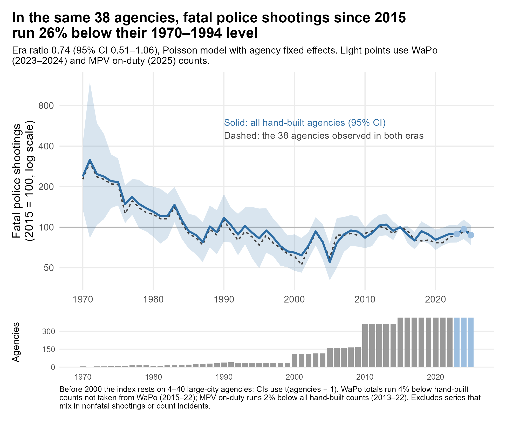
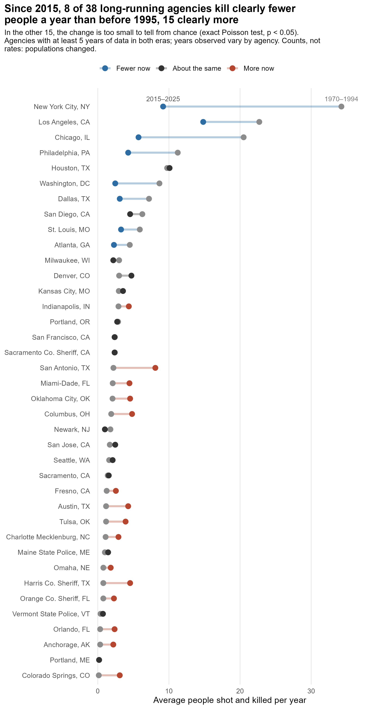
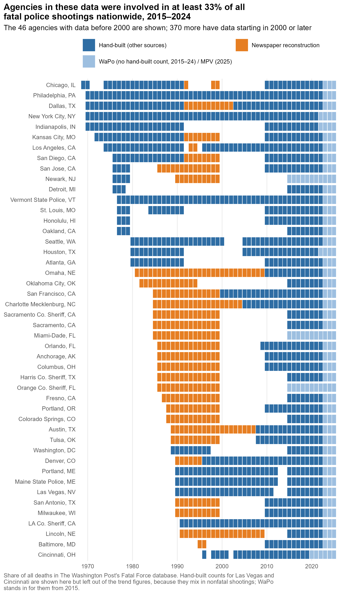
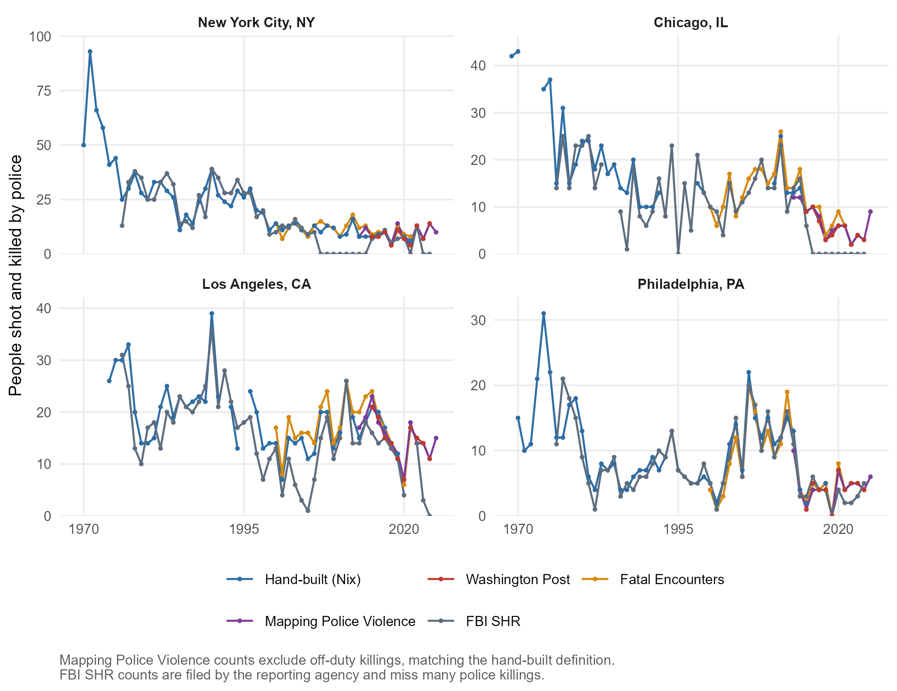

# agency-level-fatal-OIS

Annual counts of people shot and killed by on-duty police, by agency, going back as far as I can find them. The hand-built series start in 1969 for Chicago and cover 416 agencies. They sit side by side with four national sources: [*The Washington Post*'s Fatal Force](https://github.com/washingtonpost/data-police-shootings) (2015–2024), [Fatal Encounters](https://fatalencounters.org/) (2000–2021), [Mapping Police Violence](https://mappingpoliceviolence.org/) (2013–present, the only one still updating), and the FBI's Supplementary Homicide Reports (1976–2024, known to miss many police killings). Every series is keyed to the agency's FBI ORI code.

**If you just want the data:**

- [`output/agency_year_panel.csv`](output/agency_year_panel.csv) is the merged file: one row per agency-year, 4,623 agencies, 1969–2025 (145,556 agency-years). Variables are documented in [`CODEBOOK.md`](CODEBOOK.md).
- [`agency-level-fatal-ois.csv`](agency-level-fatal-ois.csv) is the original hand-built file: wide, one column per agency. It keeps the same path and format it has always had.

## What's new (November 2026)

- **Three national sources now sit beside the hand-built counts:** Fatal Encounters, Mapping Police Violence, and the FBI's Supplementary Homicide Reports (SHR, from [Jacob Kaplan's concatenated files](https://doi.org/10.3886/E100699V16)). The WaPo merge was rebuilt from checksummed local copies.
- **Twenty-two agencies' pre-2000 gaps are filled from local newspapers** (see [Newspaper reconstructions](#newspaper-reconstructions)).
- **Agency key fixes:** five wrong ORI codes corrected and four missing ones filled in.

How each source was linked, and every fix, is documented in [`data/README.md`](data/README.md#how-the-national-sources-were-merged).

## What these data can show

Are police killing more people now than in decades past? National data can't answer that, because they only start in 2000 (Fatal Encounters), 2013 (MPV), or 2015 (WaPo). But many agencies can be followed back further, and comparing each agency only to itself avoids mistaking changes in *which* agencies are observed for changes in killings.



**How the trend is estimated.** The solid line comes from a Poisson model with agency fixed effects, fit to all 416 hand-built agencies. It compares each agency with itself, so agencies entering or leaving the data don't move the line. Most hand-built counts for 2015 onward were taken from WaPo in the first place (see [Background](#background)), so WaPo fills 2015–24 wherever an agency has no hand-built count; the hand-built series end in 2022. MPV on-duty counts fill 2025 for series that reach 2024. Two hand-built series are left out because they mix in nonfatal shootings, Las Vegas and Cincinnati; WaPo stands in for both from 2015.

**How far back it reaches.** Before 2000, the solid line rests on only 4–34 departments, mostly large cities. It describes big cities, not the country.

**What it shows.** The headline compares one fixed set of agencies: the 38 with at least five years of data both before 1995 and since 2015, shown as the dashed line. In those agencies, fatal police shootings since 2015 run 26% below their 1970–1994 level (ratio 0.74, 95% CI 0.51–1.06).



**Then vs. now.** In the same 38 agencies, 8 kill clearly fewer people a year now than before 1995, 15 kill clearly more, and in 15 the change is too small to tell from chance (exact Poisson test of the two eras' yearly rates, p < .05). The drops are largest in New York, Chicago, and Los Angeles; the biggest increases are in San Antonio, Harris County, and Austin. These are raw counts, not rates per resident: some of these cities grew, while others, like St. Louis and Philadelphia, shrank.

**What the newspaper years do to the headline.** Twenty-seven of the 38 agencies include years taken from newspapers, and 22 of them qualify only because of those years.
- Dropping every newspaper year leaves 16 agencies and a ratio of 0.50 (95% CI 0.34–0.73). The 11 agencies with no newspaper years give 0.49 (0.27–0.90).
- The 25 agencies rebuilt case by case come out at 1.43 (0.98–2.09) on their own. Chicago and Los Angeles are set aside here, because their newspaper years are department counts the papers printed and their size swamps the pool. So the rebuilt cities, many of them fast-growing Sun Belt departments, mostly kill more people now than before 1995.

The reconstructions are floors, because a search can miss deaths but can't invent them. As an upper bound, raising each newspaper year to SHR's count wherever SHR is higher (an overcorrection, since SHR also counts off-duty killings) moves the headline only to 0.72 (0.51–1.02), and the 25 rebuilt cities to 1.31 (0.91–1.86). Every run is in [`era_ratio_sensitivity.csv`](output/tables/era_ratio_sensitivity.csv).



**Reach.** The 46 agencies above carry the long-run record back before 2000; orange tiles are years taken from local newspapers. Overall, the hand-built agencies were involved in at least 32% of everyone shot and killed by police in WaPo's data, 2015–2024 ("at least" because deaths are matched through each WaPo agency's primary ORI, so some matches are missed).

Numbers in this section come from [`trend_summary.csv`](output/tables/trend_summary.csv), [`trend_index.csv`](output/tables/trend_index.csv), [`then_vs_now.csv`](output/tables/then_vs_now.csv), [`era_ratio_sensitivity.csv`](output/tables/era_ratio_sensitivity.csv), and [`coverage_share.csv`](output/tables/coverage_share.csv), all written by [`scripts/07_figures_trends.R`](scripts/07_figures_trends.R).

## How the sources compare

Where they overlap, the sources mostly agree. Each row compares a national source with the hand-built counts, over the agency-years both cover:

| Compared with the hand-built counts | Years | Agency-years | Its total deaths | Same count, in years either recorded a death |
|---|---|---:|---|---:|
| *Washington Post*, against hand-built counts not taken from WaPo | 2015–2022 | 1,688 | 4.2% fewer | 74% |
| Fatal Encounters | 2000–2021 | 5,595 | 1.3% fewer | 69% |
| Mapping Police Violence (on-duty) | 2013–2022 | 3,357 | 2.2% fewer | 71% |
| FBI SHR | 1976–2022 | 3,450 | 26.7% fewer | 33% |

Most agency-years have no deaths in either source, which makes any two sources look alike. The last column drops those years, so it's the tougher test. Most hand-built counts for 2015–22 were copied from WaPo, so the WaPo row uses only the agency-years whose counts came from another documented source: the Georgia, Minnesota, and Hawaii newspaper databases and the NYPD, San Francisco, Houston, Dallas, and Springfield (MO) department data ([`nix_nonwapo_sources.csv`](data/crosswalks/nix_nonwapo_sources.csv)). Against all hand-built counts, which are mostly WaPo's own, WaPo matches in 87% of years with a death.
- **FE runs about 9% above WaPo** in the hand-built agencies, 2015–2021.
- **MPV's gap drifts:** 8–10% below the hand-built counts in 2013–15, and 3–9% above in 2020–22 ([`mpv_drift.csv`](output/tables/mpv_drift.csv)). That's why the trend figures prefer WaPo where it exists.
- Agencies that WaPo lists under several ORIs (mostly state police) are left out.

Correlations and every pairing of the national sources are in [`source_agreement.csv`](output/tables/source_agreement.csv). The agencies where the sources disagree most are listed in [`source_disagreements.csv`](output/tables/source_disagreements.csv).

**SHR runs low, and lower after 2000.** In the agency-years both cover, SHR has 7–10% fewer deaths than the hand-built counts in each decade from the 1970s through the 1990s. It has 29% fewer in the 2000s, 31% in the 2010s, and 45% in 2020–22 ([`shr_benchmark.csv`](output/tables/shr_benchmark.csv)). That isn't a fixed set of agencies, though: it grows from a few dozen big cities to 350+ after 2000. Against WaPo, FE, and MPV, SHR is 42–57% low.

Some agencies report other homicides to SHR but not their own officers' killings, which produces false zeros. New York's SHR reports list no police killings in 2007–14 (84 by the hand-built count), and Chicago's list none from 2016 on (38 in 2016–22). SHR also files a death under the reporting agency, which is sometimes the investigating agency rather than the one whose officer fired. Treat `n_shr` as a lower bound, and don't read its zeros as zero.

Against the newspaper reconstructions, SHR runs a little high, as you'd expect: it also counts off-duty killings, and a newspaper search can miss a death. In the agency-years both cover, the reconstructions count 513 deaths and SHR 565, with identical counts in 143 of 263.



The four largest local departments show how the series line up, and SHR's false zeros for New York and Chicago.

## Coverage

| Decade | Agencies with hand-built data | WaPo | FE | MPV | SHR |
|---|---:|---:|---:|---:|---:|
| 1969 | 1 (Chicago) | — | — | — | — |
| 1970s | 4–15 | — | — | — | 1,760–1,929 (1976+) |
| 1980s | 12–27 | — | — | — | 1,695–1,960 |
| 1990s | 28–35 | — | — | — | 1,459–1,818 |
| 2000s | 114–172 | — | 2,967 | — | 1,524–1,721 |
| 2010s | 361–369 | 3,647 (2015+) | 2,967 | 4,622 (2013+) | 1,584–1,841 |
| 2020s | 225–368 (through 2022) | 3,647 (through 2024) | 2,967 (through 2021) | 4,622 (through 2025) | 1,864–2,098 (through 2024) |

The WaPo, FE, and MPV columns count agencies with an ORI. WaPo and MPV are national censuses, so an agency gets a zero from each where that source recorded no deaths. There is one exception: agencies known only from MPV get NA for WaPo rather than zero, because WaPo having no agency with that code can reflect a coding difference. The FE column counts linked agencies only. The SHR column counts panel agencies that filed any SHR record that year.

## Background

I'm building a database of fatal officer-involved shootings at the agency-year level, going back in time as far as possible. [This article in *The Lancet*](https://t.co/zDLTHrysAv) suggests police are killing more people today than they did in the 1980s, but [I remain skeptical](https://twitter.com/jnixy/status/1635677916762886149). So I'm compiling annual counts of people shot and killed by on-duty officers for as many agencies as I can.

I started with this excellent book:

- William A. Geller & Michael S. Scott (1992). *Deadly Force: What We Know.* Police Executive Research Forum.

It contains yearly counts of fatal and nonfatal police shootings for the following agencies:

| Agency | Years included |
|---|:---:|
| Chicago | 1974–91 |
| Dallas | 1970–91 |
| Philadelphia | 1986–91 |
| NYPD | 1970–91 |
| LAPD | 1980–91 |
| Houston | 1980–91 |
| Atlanta | 1980–91 |
| St. Louis | 1984–91 |
| San Diego | 1980–91 |
| Indianapolis | 1970–91 |
| Kansas City, MO | 1972–91 |

I decided, for now at least, to focus on fatal shootings, since they're more reliably reported. From there, I gathered more recent data from the sources below. I started with the largest 100 or so agencies, but added others, regardless of size, as I came across them. For 2015–2022, most hand-built counts come from WaPo. The exceptions are agencies where I took the counts from another newspaper's database (as in Georgia, Minnesota, and Hawaii) or from the agency's own data (as for NYPD, San Francisco, Houston, and Dallas), listed below.

| Source | Years included | Coverage |
|---|:---:|---|
| [Washington Post](https://github.com/washingtonpost/data-police-shootings) | 2015–2024 | Nationwide (most hand-built counts for 2015–22; fills 2015–24 in the trend figures where there is no hand-built count) |
| [Fatal Encounters](https://fatalencounters.org/) | 2000–2021 | Nationwide (separate column; not used to fill gaps) |
| [Mapping Police Violence](https://mappingpoliceviolence.org/) | 2013–present | Nationwide (separate column; fills 2025 in the trend figures) |
| [Tampa Bay Times](https://projects.tampabay.com/projects/2017/investigations/florida-police-shootings/database/) | 2009–2014 | Florida |
| [Honolulu Civil Beat](https://cbmultimedia.pythonanywhere.com/) | 2010–2022 | Hawaii |
| [Salt Lake Tribune](http://local.sltrib.com/charts/shootings/policeshootings.html) | 2005–2014 | Utah |
| [Maine Attorney General's Office](https://www.pressherald.com/interactive/maine-police-deadly-force-lethal-database/) | 1990–2012 | Maine |
| [Atlanta Journal-Constitution](https://investigations.ajc.com/overtheline/database/) | 2010–2020 | Georgia |
| [Star Tribune](https://www.startribune.com/every-police-involved-death-in-minnesota-since-2000/502088871/) | 2000–2022 | Minnesota |
| [Vice News](https://news.vice.com/en_us/article/a3jjpa/nonfatal-police-shootings-data) | 2010–2016 | 50 largest local police departments |
| *The Texas Tribune's* ["Unholstered" data](https://apps.texastribune.org/unholstered/) | 2010–2015 | 36 largest cities in Texas |
| [Binder, Scharf, & Galvin (1983)](https://nij.ojp.gov/library/publications/use-deadly-force-police-officers-final-report) | 1976–1979 | Detroit, Honolulu, Newark, Oakland, San Diego, San Jose, St. Louis |
| *Washington Post* [story from 1998](https://www.washingtonpost.com/wp-srv/local/longterm/dcpolice/deadlyforce/police1page1.htm) | 1989–1997 | DC Metro PD |
| [NYPD](https://www.nyc.gov/site/nypd/stats/reports-analysis/use-of-force.page) | 1971–2022 | NYPD |
| [San Francisco PD](https://www.sanfranciscopolice.org/sites/default/files/2022-02/SFPDOISInvestigationsSheet20220215.pdf) | 2000–2022 | San Francisco PD |
| [Houston PD](https://www.houstontx.gov/police/ois/) | 2005–2022 | Houston PD |
| [Springfield (MO) PD](https://www.springfieldmo.gov/3755/Officer-Involved-Shootings) | 2008–2022 | Springfield (MO) PD |
| [Austin open data portal](https://data.austintexas.gov/Public-Safety/Officer-Involved-Shooting-2000-2014/63p6-iegi) | 2008–2014 (2000–07 replaced by the Statesman reconstruction) | Austin PD |
| [Dallas open data portal](https://www.dallasopendata.com/Public-Safety/Dallas-Police-Officer-Involved-Shootings/4gmt-jyx2) | 2003–2022 | Dallas PD |
| Local newspapers via NewsBank: see [Newspaper reconstructions](#newspaper-reconstructions) below | 1981–2009 | Omaha, Lincoln, Oklahoma City, Columbus, Denver, Tulsa, San Antonio, Sacramento PD, Sacramento Co. SD, Portland (OR), Austin, Harris Co. SO, Charlotte, Fresno, San Jose, Dallas, San Diego, Kansas City (MO), Chicago, LAPD (1993–94), Milwaukee, San Francisco, Colorado Springs, Orlando, Anchorage, Baltimore (1995–96), Newark, Miami-Dade, Orange Co. SO (FL) |
| Jacksonville Sheriff's Office, [*Police Involved Shootings*](https://web.archive.org/web/20150717050006/http://www.jaxsheriff.org/departments/sheriffs-office/docs/sheriff-john-rutherford/police-involved-shootings-final.aspx) (Jan. 2009; archived copy) | 2007–2008 | Jacksonville SO |
| [Cincinnati open data portal](https://data.cincinnati-oh.gov/Safety/PDI-Police-Data-Initiative-Officer-Involved-Shooti/r6q4-muts) | 1996–2019 | Cincinnati PD |
| [Vermont open data portal](https://data.vermont.gov/Public-Safety/Vermont-State-Police-Officer-Involved-Shootings-19/du86-kfnp) | 1977–2022 | Vermont State Police |
| [COPS Office report on LVMPD](https://cops.usdoj.gov/RIC/Publications/cops-p273-pub.pdf) | 1990–2011 | Las Vegas Metro PD |
| [ACLU report](https://www.aclusocal.org/sites/default/files/aclu_socal_report_on_apd_use_of_force_nov_2017.pdf) (Nov. 2017) | 2003–2016 | Anaheim PD |
| [Mike White](https://cvpcs.asu.edu/sites/default/files/content/projects/ER%20-%20external%20DF.pdf) | 1970–1992 | Philadelphia PD |
| [David Klinger](https://journals.sagepub.com/doi/10.1177/1088767911430861) | 1996–2008 | LAPD, LASD |
| LASD Special Counsel Merrick J. Bobb, semiannual reports [5th](https://clearinghouse-umich-production.s3.amazonaws.com/media/doc/5168.pdf) (1996), [10th](https://clearinghouse-umich-production.s3.amazonaws.com/media/doc/5173.pdf) (1999), and [30th](https://clearinghouse-umich-production.s3.amazonaws.com/media/doc/42738.pdf) (2011): people killed in hit shootings. For 1996–2008 the hand-built series keeps Klinger's counts; Bobb's run about 5% higher (155 vs. 147), by at most 2 a year | 1991–1995, 2009 | LASD |
| [LASD person-level shooting data](https://services.arcgis.com/RmCCgQtiZLDCtblq/arcgis/rest/services/Person_Details_Suspect_Involved_Shootings/FeatureServer/0) (LA County open data): people recorded as deceased | 2010–2014 | LASD |
| [Report on police shootings in Alaska](https://scholarworks.alaska.edu/handle/11122/11933) | 2010–2020 | Anchorage PD |
| [SPD use-of-force report](https://s3-us-west-2.amazonaws.com/docs.puppycidedb.com/seattlepd/UseofForce2000.PDF) | 1980–2001 | Seattle PD |
| [Denver independent monitor](https://s3-us-west-2.amazonaws.com/docs.puppycidedb.com/denverpd/OIM/Annual+Reports/2006_Annual+Report.pdf) | 1996–2006 | Denver PD |
| Rojek, Nix, Wolfe, et al. (2019), [*Analysis of 2018 Use of Deadly Force by the Phoenix Police Department*](https://jnix.netlify.app/files/pdfs/report_pf_phx_ois.pdf), National Police Foundation | 2009–2018 | Phoenix PD |
| [Phoenix open data portal](https://www.phoenixopendata.com/dataset/ois) | 2017–2022 | Phoenix PD |

### Newspaper reconstructions

For twenty-two agencies, years missing from the hand-built series come from local newspapers, searched through NewsBank's Access World News. A death counts when the paper reports that an on-duty officer of that agency shot and killed someone; off-duty officers and other agencies at the same scene are left out. Most years were rebuilt case by case and are best read as floors. Chicago's and Los Angeles's are department counts the papers printed. SHR, shown for comparison, also counts off-duty killings.

The method, a note on every agency, and the checks against each paper's own counts are in [`data/historical/README.md`](data/historical/README.md). Every case and every exclusion is logged with its source in [`historical_ois_evidence.csv`](data/historical/historical_ois_evidence.csv).

| Agency | Paper | Years | Deaths | SHR |
|---|---|:---:|---:|---:|
| Omaha PD | *Omaha World-Herald* | 1981–2009 | 25 | 9 |
| Lincoln PD | *Omaha World-Herald* | 1991–2009 | 4 | 3 |
| Oklahoma City PD | *The Daily Oklahoman* | 1982–1994 | 27 | 36 |
| Columbus (OH) PD | *The Columbus Dispatch* | 1986–1999 | 23 | 21 |
| Denver PD | *The Denver Post*; *Rocky Mountain News* | 1990–1995 | 19 | 20 |
| Tulsa PD | *Tulsa World* | 1989–1999 | 17 | 18 |
| San Antonio PD | *San Antonio Express-News* | 1990–1999 | 20 | — |
| Sacramento PD | *The Sacramento Bee* | 1985–1999 | 18 | 21 |
| Sacramento County SD | *The Sacramento Bee* | 1985–1999 | 28 | 43 |
| Portland PD (OR) | *The Oregonian* | 1988–1999 | 26 | 26 |
| Austin PD | *Austin American-Statesman* | 1989–2007 | 19 | 18 |
| Harris County SO (TX) | *Houston Chronicle* | 1986–1999 | 10 | 17 |
| Charlotte PD / CMPD | *The Charlotte Observer* | 1985–2004 | 24 | 25 |
| Fresno PD | *The Fresno Bee* | 1987–1999 | 24 | 22 |
| San Jose PD | *San Jose Mercury News* | 1986–1999 | 29 | 31 |
| Dallas PD | *The Dallas Morning News* | 1992–2002 | 21 | 38 |
| San Diego PD | *San Diego Union*; *San Diego Union-Tribune* | 1992–1999 | 44 | 51 |
| Kansas City (MO) PD | *The Kansas City Star* | 1992–1999 | 18 | 10 |
| Chicago PD | *Chicago Sun-Times* | 1992, 1998–1999 | 41 | 50 |
| LAPD | *Daily News of Los Angeles* | 1993–1994 | 34 | 39 |
| Milwaukee PD | *The Milwaukee Journal*; *Milwaukee Sentinel*; *Milwaukee Journal Sentinel* | 1990–1999 | 25 | 27 |
| San Francisco PD | *San Francisco Chronicle* | 1985–1999 | 35 | 40 |
| Colorado Springs PD | *The Gazette* (Colorado Springs) | 1988–1999 | 4 | 2 |
| Orlando PD | *Orlando Sentinel* | 1986–1999 | 6 | 1 |
| Anchorage PD | *Anchorage Daily News* | 1986–1999 | 4 | 5 |
| Baltimore PD | *The Sun* (Baltimore) | 1995–1996 | 21 | 21 |
| Newark PD (NJ) | *The Star-Ledger* | 1990–1999 | 18 | 24 |
| Miami-Dade PD (Metro-Dade PD before 1997) | *The Miami Herald* | 1985–1999 | 33 | 5 |
| Orange Co. SO (FL) | *Orlando Sentinel* | 1986–1999 | 11 | 2 |


## Caveats

1. **Any mistakes are mine.** I did my best to make sure the data permit apples-to-apples comparisons. Each number *should* represent a person fatally shot by an on-duty officer. A few exceptions are known:
   - **Cincinnati before 2015 and all of LVMPD** count fatal and nonfatal shootings together (animal shootings excluded). That's why Cincinnati is the big outlier in [`output/figures/source_agreement.png`](output/figures/source_agreement.png).
   - **Athens-Clarke 2019:** the hand-built count (5) equals WaPo's police department and sheriff's office combined. The AJC data may combine the two agencies.
2. **Blank is not zero** in the hand-built series. A blank means I have no data for that agency-year.
3. **How the national sources are counted:**
   - **WaPo and MPV zeros are mostly real.** Both are national censuses, so an agency with no record in a year gets 0. The exception is an agency one source files under a different ORI than the other. The MPV alias and code mappings fix the cases that can be detected, and agencies known only from MPV get NA for WaPo.
   - **FE zeros are real only for linked agencies.** For an agency linked to FE, 0 means no FE deaths that year. An agency never linked to FE is left NA, because a missed name match is not a zero.
   - **Pre-2013 FE is less reliable.** It was assembled after the fact from news reports, so treat the early years with more caution than WaPo.
   - **FE's "Deadly force" code is not purely on-duty police shootings.** About 5% of the deaths it keeps have descriptions mentioning a self-inflicted, accidental, or off-duty shooting. Examples include murder-suicides by off-duty officers and a training accident. Some of these are legitimate police shootings (an off-duty officer stopping a robbery), so they are flagged in `n_fe_flagged`, not dropped. Subtract `n_fe_flagged` for a conservative count. Flagged deaths explain roughly half of FE's excess over WaPo.
4. **Multi-agency incidents.** In WaPo, FE, and MPV, a death involving several agencies counts once for each agency listed. `n_fe_multi` and `n_mpv_multi` report how many of an agency's deaths were shared. Don't sum the national columns across agencies and call it a national total.
5. **Agencies WaPo lists under several ORIs** (mostly state police and highway patrols) are each assigned one primary ORI and flagged `wapo_multi_ori`. WaPo also splits Georgia State Patrol into two records; both are assigned to GAGSP00 (see `scripts/02_wapo.R`).
6. **Off-duty killings.** The hand-built series counts on-duty shootings. MPV includes off-duty killings in `n_mpv` and counts them in `n_mpv_offduty`; subtract them to match the hand-built definition. WaPo includes off-duty officers acting in an official capacity.
7. **MPV coverage has grown over time.** Against the hand-built counts it runs about 10% low in 2013–15 and a few percent high in 2020–22. Trends built only from MPV may overstate recent increases.
8. **SHR undercounts, and by different amounts in different decades** (see [How the sources compare](#how-the-sources-compare)). Its zeros can be false, and its 2021 count is depressed by the FBI's move to NIBRS.

## Reproducing the panel

Requires R (≥ 4.3) and the packages `tidyverse`, `here`, `janitor`, `digest`, `scales`, `fixest`, and `patchwork`. To use a newer MPV snapshot, first run (Python, with `requests` and `pandas`):

```sh
python tools/fetch_mpv/fetch_mpv.py
```

That saves a dated copy of MPV's current data to `data/raw/mpv/` and records it in [`data/crosswalks/mpv_snapshots.csv`](data/crosswalks/mpv_snapshots.csv). The pipeline always uses the newest snapshot. Then, from the project root:

```sh
Rscript scripts/00_run_all.R
```

| Script | What it does |
|---|---|
| `01_nix_long.R` | Reshapes the hand-built file to agency-year and attaches ORIs |
| `02_wapo.R` | Builds WaPo agency-year counts |
| `03_fe_crosswalk.R` | Builds the FE name → ORI crosswalk and writes the review queue to `output/fe_review/` |
| `04_fe.R` | Builds FE agency-year counts and the linkage table |
| `04b_mpv.R` | Builds MPV agency-year counts: ORI aliases, name recovery, linkage table |
| `04c_shr.R` | Builds FBI SHR agency-year counts (police killings with a firearm) and the linkage table |
| `05_combine.R` | Builds the panel, the agreement and coverage tables |
| `06_figures.R` | Draws the source-comparison figures |
| `07_figures_trends.R` | Draws the trend, then-vs-now, and coverage figures |

The WaPo raw files are in the repo, with checksums. Four inputs are not:
- **Fatal Encounters final release** (needed for steps 03–04): linked rather than redistributed.
- **MPV snapshot** (step 04b): linked rather than redistributed; fetch it as above.
- **Kaplan's concatenated SHR** (step 04c): distributed by ICPSR through openICPSR (project 100699); linked rather than redistributed.
- **Law Enforcement Agency Identifiers Crosswalk** (ICPSR 35158, step 03): ICPSR's terms don't let me redistribute it.

 [`data/README.md`](data/README.md) says where to get each. The published outputs are already in the repo either way.

To add an FE match or correct one:
1. Check `output/fe_review/` for candidates, then add a row to `data/crosswalks/fe_crosswalk_decisions.csv`.
2. Rerun the pipeline.

## Contributing

Found an error, or a source I've missed? Open an issue. Thanks to [Ash Bruha](https://www.viprlab.org/author/ash-bruha/) of the [VIPR Lab](https://www.viprlab.org/) for the Seattle and Denver series (Nov. 2025).

`tools/historical_ois/` holds the tools used to look for counts from before each series begins. They rank agencies, search the Wayback Machine for archived department reports, and log every count found to [`data/historical/historical_ois_evidence.csv`](data/historical/historical_ois_evidence.csv). Each logged count has its source, page, and a verbatim quote. Counts of incidents, or of everyone shot rather than people killed, are logged there but kept out of the panel. The January 2026 website scraper these tools replace is archived in `tools/data_source_scouting/archive/`.

## Citation

See [`CITATION.cff`](CITATION.cff). Please also cite *The Washington Post*, Fatal Encounters, and Mapping Police Violence if you use their series. If you use `n_shr`, cite Kaplan, J. *Jacob Kaplan's Concatenated Files: Uniform Crime Reporting (UCR) Program Data: Supplementary Homicide Reports (SHR), 1976–2024.* Ann Arbor, MI: Inter-university Consortium for Political and Social Research [distributor]. https://doi.org/10.3886/E100699V16

## License

- **Code** (`scripts/`, `tools/`) is released under the [MIT License](LICENSE).
- **Data** (everything under `data/` and `output/`, plus `agency-level-fatal-ois.csv`) is released under [CC BY-NC-SA 4.0](LICENSE-DATA). The merged panel adapts *The Washington Post*'s Fatal Force data, which carries the same license, and share-alike requires adaptations to keep it.

## Earlier updates

- **11.20.2025.** Ash Bruha found fatal OIS data for **Seattle PD**, 1980 through mid-2001, in [an SPD report](https://s3-us-west-2.amazonaws.com/docs.puppycidedb.com/seattlepd/UseofForce2000.PDF). She also found data for **Denver PD**, 1996–2006, in an [independent monitor's report](https://s3-us-west-2.amazonaws.com/docs.puppycidedb.com/denverpd/OIM/Annual+Reports/2006_Annual+Report.pdf).
- **1.4.2025.** First WaPo merge (see this [blog post](https://jnix.netlify.app/post/post27-historical-ois-update/)). It now lives in `scripts/02_wapo.R`.
